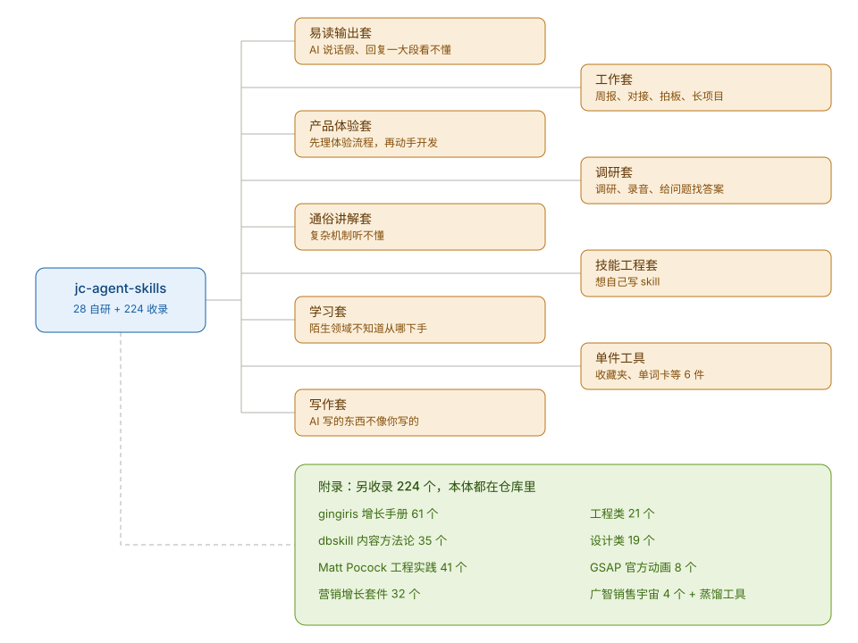

# jc-agent-skills

26 个 Agent Skill，各自管一类具体问题。不用懂原理，按你遇到的问题选一套，复制提示词发给你的 AI，它自己装好。



## 按问题选一套

### AI 说话假、回复一大段看不懂：易读输出套

- [`jc-no-ai-flavor-latest`](jc-no-ai-flavor-latest/)：AI 回复又长又假、看着累，所以做了它。管结论先行、篇幅和文味，目标是 30 秒看懂一条回复。
- [`jc-markdown-visual-writer-latest`](jc-markdown-visual-writer-latest/)：纯文字看不懂、想先看图，所以做了它。用 Mermaid 把流程和结构画出来。

这套是其他几套的底座，建议第一个装。

```text
克隆 https://github.com/yht-4403/jc-agent-skills ，把 jc-no-ai-flavor-latest、jc-markdown-visual-writer-latest 这两个目录复制到我当前平台的 skills 目录（WorkBuddy 是 ~/.workbuddy/skills/，Claude Code 是 ~/.claude/skills/，Codex 是 ~/.codex/skills/）。装完告诉我每个管什么，从下一条回复起按 jc-no-ai-flavor-latest 的规则输出。
```

验证：随便问个复杂问题，看它是不是先给结论、段落变短。

### 复杂机制听不懂：通俗讲解套

- [`jc-plain-explainer`](jc-plain-explainer/)：问机制原理时 AI 净说术语，所以做了它。它用一个具体例子带你走完一遍真实过程。
- [`jc-html-lecture`](jc-html-lecture/)：听完想留一份能标注、能补充的讲解页，所以做了它。

先装易读输出套。

```text
克隆 https://github.com/yht-4403/jc-agent-skills ，把 jc-plain-explainer、jc-html-lecture 这两个目录复制到我当前平台的 skills 目录（WorkBuddy 是 ~/.workbuddy/skills/，Claude Code 是 ~/.claude/skills/，Codex 是 ~/.codex/skills/）。装完告诉我每个管什么，之后我问机制原理时按它们的规则讲。
```

验证：问一个一直觉得抽象的机制，比如「HTTPS 握手」，看它是不是用具体例子讲。

### 要系统学一个陌生领域：学习套

- [`jc-learning-map`](jc-learning-map/)：面对陌生领域不知道从哪下手，所以做了它。先给你画一张知识地图，标出卡点和第一步。
- [`jc-learning`](jc-learning/)：地图有了想逐个深入，所以做了它。

```text
克隆 https://github.com/yht-4403/jc-agent-skills ，把 jc-learning、jc-learning-map 这两个目录复制到我当前平台的 skills 目录（WorkBuddy 是 ~/.workbuddy/skills/，Claude Code 是 ~/.claude/skills/，Codex 是 ~/.codex/skills/）。装完告诉我每个管什么。
```

验证：让它给一个陌生领域画学习地图，看是不是先出全景再讲细节。

### 写文案、发内容：写作套

- [`jc-voice`](jc-voice/)：AI 写的东西不像你写的，所以做了它。仓库里是脱敏示例，把手写原文换进 references/ 才有完整效果。
- [`jc-site-copy`](jc-site-copy/)：官网、落地页文案写出来没重点，所以做了它。
- [`jc-knowledge-capture`](jc-knowledge-capture/)：对话和灵感散在各处，想整理成能回顾的文档，所以做了它。
- [`jc-daily-thought-social-publisher-v5`](jc-daily-thought-social-publisher-v5/)：长文想改成社媒能发的短文，所以做了它。

```text
克隆 https://github.com/yht-4403/jc-agent-skills ，把 jc-voice、jc-site-copy、jc-knowledge-capture、jc-daily-thought-social-publisher-v5 这四个目录复制到我当前平台的 skills 目录（WorkBuddy 是 ~/.workbuddy/skills/，Claude Code 是 ~/.claude/skills/，Codex 是 ~/.codex/skills/）。装完告诉我每个管什么、什么时候触发。
```

### 日报周报、工作对接：工作套

- [`jc-report`](jc-report/)：周报写出来全是技术细节、领导看不懂，所以做了它。
- [`jc-work-coordination`](jc-work-coordination/)：情况说明发出去对方不知道要干嘛，所以做了它。
- [`jc-decision-grade`](jc-decision-grade/)：方案讨论半天没人敢拍板，所以做了它。
- [`jc-project-loop`](jc-project-loop/)：长项目跨好几次对话，每次都从头讲，所以做了它。

先装易读输出套。

```text
克隆 https://github.com/yht-4403/jc-agent-skills ，把 jc-report、jc-work-coordination、jc-decision-grade、jc-project-loop 这四个目录复制到我当前平台的 skills 目录（WorkBuddy 是 ~/.workbuddy/skills/，Claude Code 是 ~/.claude/skills/，Codex 是 ~/.codex/skills/）。装完告诉我每个管什么。
```

验证：把一周的工作流水发给它出周报，看有没有测试计数、错误码这类不该出现的细节。

### 调研公司、整理录音：调研套

- [`jc-company-research`](jc-company-research/)：调研一家公司越查越散，所以做了它。先定这次调研支撑什么输出，再倒推查多深。
- [`jc-audio-transcriber`](jc-audio-transcriber/)：一堆录音想变成能搜的文字，所以做了它。依赖本地 ASR 工具链，装前看它 SKILL.md 里的环境要求。

```text
克隆 https://github.com/yht-4403/jc-agent-skills ，把 jc-company-research、jc-audio-transcriber 这两个目录复制到我当前平台的 skills 目录（WorkBuddy 是 ~/.workbuddy/skills/，Claude Code 是 ~/.claude/skills/，Codex 是 ~/.codex/skills/）。装完告诉我每个管什么、需要什么环境。
```

### 做前端设计：前端套

- [`jc-frontend-uiux`](jc-frontend-uiux/)：AI 生成的界面看着乱又说不出哪不对，所以做了它。动手前先定设计预算，生成后照清单自查。
- [`jc-frontend-workflow`](jc-frontend-workflow/)：想整体重做设计又怕改崩现有代码，所以做了它。

```text
克隆 https://github.com/yht-4403/jc-agent-skills ，把 jc-frontend-uiux、jc-frontend-workflow 这两个目录复制到我当前平台的 skills 目录（WorkBuddy 是 ~/.workbuddy/skills/，Claude Code 是 ~/.claude/skills/，Codex 是 ~/.codex/skills/）。装完告诉我每个管什么。
```

### 想自己写 skill：技能工程套

- [`jc-skills-creator`](jc-skills-creator/)：想写 skill 但不知道值不值得写、怎么写，所以做了它。
- [`jc-skill-installer`](jc-skill-installer/)：skill 多了管不过来，所以做了它。

```text
克隆 https://github.com/yht-4403/jc-agent-skills ，把 jc-skills-creator、jc-skill-installer 这两个目录复制到我当前平台的 skills 目录（WorkBuddy 是 ~/.workbuddy/skills/，Claude Code 是 ~/.claude/skills/，Codex 是 ~/.codex/skills/）。装完告诉我每个管什么。
```

### 单件工具

这几个单独装就有用：

- [`jc-bookmarks`](jc-bookmarks/)：浏览器收藏夹攒了几千条没法用，所以做了它。
- [`jc-english-chunk-cards`](jc-english-chunk-cards/)：学英语不想背单词书，想把日常语料做成卡片，所以做了它。
- [`jc-quiet-ad`](jc-quiet-ad/)：想做不像广告的品牌广告，所以做了它。
- [`jc-client-howto-guide`](jc-client-howto-guide/)：产品交付了客户不会用，所以做了它。
- [`jc-concept-deconstruct`](jc-concept-deconstruct/)：读完文章、课程想拆成能用的概念，所以做了它。
- [`jc-rich-doc-publisher`](jc-rich-doc-publisher/)：文章要发给客户或对外展示，想一键变成飞书、腾讯文档里排版好看的格式，所以做了它。依赖飞书 CLI 和腾讯文档 MCP，装前需要这两个工具。

## 想全装

```text
克隆 https://github.com/yht-4403/jc-agent-skills ，把仓库里 jc- 开头的技能目录全部复制（或软链）到我当前平台的 skills 目录（WorkBuddy 是 ~/.workbuddy/skills/，Claude Code 是 ~/.claude/skills/，Codex 是 ~/.codex/skills/）。装完列出装了哪些、各自什么时候触发。
```

## 这些 skill 是怎么做出来的

做法只有一条主线：先把要解决的问题说清楚，再让 AI 去找这个专业领域历史上最好的解法——谁解决过、用什么理论、用什么工具，然后一比一复刻，详细到他们用什么工具我们就用什么工具。比如复刻一个人的语言习惯，就去找语言修辞学和刑侦语言鉴定的底层论文，而不是凭感觉总结。

做出来之后不算完：写正例反例，跑多轮机器评测，按 V1、V2、V3 加 latest 的版本管理一路迭代，直到在日常工作里稳定好用。

## License

[MIT](LICENSE)
