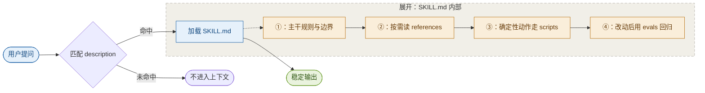

# jc-agent-skills

规则塞进系统提示词，是越攒越管不住的。

这个仓库是另一种做法：25 个 Agent Skill，各自只在任务相关时才加载。什么时候该用、怎么做、做成什么样算合格，写在各自的位置。写作、调研、学习、工作对接、前端设计都有，全部来自日常工作里的真实使用：某次输出翻车了，写下规则；规则太长，拆成按需读取的细节；需要稳定输出，改成脚本；改完跑回归用例，确认没退化。

## 一个技能如何进入工作

从提问到输出，一个技能经历这几步：



触发看 `description` 一句话；`SKILL.md` 只放主干，细节按需读取；每次修改跑 `evals/`，确认原本能过的用例没退化。

## 技能清单

### 写作与表达

| 技能 | 解决什么问题 |
| --- | --- |
| [`jc-voice`](jc-voice/) | 个人写作嗓音系统。写对外说明与对用户说话的内容时，按场景选定一种嗓音 |
| [`jc-site-copy`](jc-site-copy/) | 中文官网、落地页、定价页和界面文案。先判断页面类型，再按字数预算写 |
| [`jc-knowledge-capture`](jc-knowledge-capture/) | 把对话、灵感、方案整理成可回顾的知识文档，或转成适合公开发布的直述体 |
| [`jc-daily-thought-social-publisher-v5`](jc-daily-thought-social-publisher-v5/) | 把知识库长文改成单主题社媒文案 |
| [`jc-markdown-visual-writer-latest`](jc-markdown-visual-writer-latest/) | 在 Markdown 文档、README、知识库中用 Mermaid 图讲清流程与结构，只维护「主线 + 细节展开」一种图形语言 |
| [`jc-concept-deconstruct`](jc-concept-deconstruct/) | 把文章、课程、论文按固定结构拆成概念字典、案例拆解和商业化判断题 |
| [`jc-client-howto-guide`](jc-client-howto-guide/) | 为已交付的产品、账号、设备写客户照着能做完的图文操作指引：开箱清单、绑定验证、上手步骤、售后入口 |

### 学习与研究

| 技能 | 解决什么问题 |
| --- | --- |
| [`jc-learning`](jc-learning/) | 地图先行的工具箱学习法。先出 8–12 个思维工具的全景地图，再逐讲深入 |
| [`jc-learning-map`](jc-learning-map/) | 为陌生领域画可行动的知识地图，标注卡点和第一步 |
| [`jc-english-chunk-cards`](jc-english-chunk-cards/) | 把日常语料拆成语义块，制卡并写入墨墨背单词牌组 |
| [`jc-audio-transcriber`](jc-audio-transcriber/) | 把录音文件夹批量转成逐字稿，加一份精简知识文档 |
| [`jc-company-research`](jc-company-research/) | 公司调研的倒推法。先定这次调研支撑哪个输出，再倒推查什么、查多深、什么算够了 |
| [`jc-html-lecture`](jc-html-lecture/) | 生成可标注、可持续拓展的中文 HTML 讲解页，能标记不懂的位置再增量补章节 |
| [`jc-plain-explainer`](jc-plain-explainer/) | 把复杂机制讲得通俗但不失真。让一个具体对象完整经历一次事件，原始制品优先，术语最后引入 |

### 工作与协作

| 技能 | 解决什么问题 |
| --- | --- |
| [`jc-decision-grade`](jc-decision-grade/) | 把方案做成可下注的决策交付。先立事实底稿与反例，再用基准率、预验尸和外部验收压住判断 |
| [`jc-report`](jc-report/) | 日报、周报、月报、阶段总结的统一规范，写清结论、进展、验证和风险 |
| [`jc-work-coordination`](jc-work-coordination/) | 把情况说明改成可直接发出的工作对接消息，按接收人职责保留行动和必要事实 |
| [`jc-project-loop`](jc-project-loop/) | 用本地任务账本持续推进、复核和恢复跨会话的长周期项目 |
| [`jc-rich-doc-publisher`](jc-rich-doc-publisher/) | 把长内容做成适合手机和电脑阅读的富文档，处理云文档协作、权限和发布后校验 |
| [`jc-bookmarks`](jc-bookmarks/) | 整理浏览器收藏夹。收敛层级、按用途分类、品牌化命名、厂商分组排序，处理成可检索的结构 |

### 技能工程

| 技能 | 解决什么问题 |
| --- | --- |
| [`jc-skills-creator`](jc-skills-creator/) | 创建、审查、迭代带明确边界和评估的 Agent Skill。先证明它该存在，再动手写 |
| [`jc-skill-installer`](jc-skill-installer/) | 搜索、安装、启停、去重、版本管理个人 Skill 库，并同步到多个 Agent 平台 |

### 前端与设计

| 技能 | 解决什么问题 |
| --- | --- |
| [`jc-frontend-uiux`](jc-frontend-uiux/) | 前端界面设计纪律。动手前先写设计预算，生成后做冗余、层次、颜色三组自查 |
| [`jc-frontend-workflow`](jc-frontend-workflow/) | 前端整体重设计工作流。从真实任务出发，经参考站拆解、独立原型和截图迭代，固化规则后分批迁入正式代码 |
| [`jc-quiet-ad`](jc-quiet-ad/) | 做或评「不像广告」的品牌广告：户外大屏、地铁灯箱、品牌主视觉。靠延迟观众把它归类为广告的那一秒 |

## 两步就能用

复制下面这段提示词，发给你正在用的 AI（Claude Code、Codex、WorkBuddy 等），它会自己装好：

```
把 https://github.com/yht-4403/jc-agent-skills 这个仓库的技能装到我当前用的平台：克隆仓库，把里面 jc- 开头的技能目录全部软链（或复制）到当前平台的 skills 目录；装完列出装了哪些技能、各自什么时候会触发。
```

只想用某一个，告诉它只装那一个就行。

## 一个技能长什么样

以 `jc-company-research` 为例：

```text
jc-company-research/
├── SKILL.md                  # 触发条件、边界、主流程
├── references/
│   ├── research-protocol.md  # 调研的完整步骤
│   ├── evidence-layers.md    # 证据分层：什么算查到
│   ├── stage-inference.md    # 从公开信息推公司阶段
│   ├── scenario-reverse-lookup.md
│   ├── spoken-script.md      # 交付物的口播结构
│   └── delivery-contract.md
├── evals/cases.md            # 回归用例
└── agents/openai.yaml        # 跨平台元数据与调用策略
```

`SKILL.md` 只放主干和路由，细节沉到 `references/` 按需读取，避免每次触发都吃掉一大块上下文。

## 写这些技能时定下的几条

完整版本在 `jc-skills-creator` 里，这几条是反复吃过亏之后留下的：

- 先证明该存在，再写。模型没有这个技能时是不是已经做得好？一句临时提示够不够？问题是不是只是确定性重复执行、应该写脚本？三个都能否掉，才值得做成技能。
- 边界写成否定句。每个技能的 description 都写明「不用于什么」。不写否定边界的技能会被错误触发，然后污染输出。
- 证据优先于措辞。没有材料支撑的判断不写进去；不确定的部分标成待核实，不用确定的语气糊过去。
- 确定性的交给脚本，判断留给模型。文件名解析、目录扫描、接口调用写进 `scripts/`，不让模型每次自由发挥；需要权衡的部分才留给判断。
- 用评估回归，不靠感觉。改完技能跑 `evals/`，确认原本能过的用例没退化。

## 这些技能不是通用产品

它们按作者自己的工作环境写成：一部分读写个人知识库结构（`jc-report` 写日记、`jc-learning` 读学习地图），一部分绑定个人文风（`jc-voice`），一部分依赖本地工具链（`jc-audio-transcriber` 依赖本地 ASR）。直接装进你的环境，触发可能正常，输出会指向不存在的东西。

建议当方法论参考读，不当插件装。想复用的部分，抄结构、改路径、换掉个人设定，比直接拿来用更靠谱。

两点处理方式需要说明：

- `jc-voice` 里用于校准语感的原文锚点，在这个仓库中替换成了虚构示例。它的约束力来自「这句话真的被人确认过」，虚构示例只能示范结构。自己用时，把手写原文替换进 `references/` 才有完整效果。
- `jc-skill-installer` 的机器级状态文件（`active-skills.json` 等）不版本化。它们记录本机技能清单和绝对路径，换机器时要重新 bootstrap。

## 更新方式

日常编辑发生在本地 Skill 库，仓库只保留技能本体；运行时状态文件留在库里，不进 git。发布时用 [`scripts/sync-from-library.sh`](scripts/sync-from-library.sh) 单向同步：

```bash
./scripts/sync-from-library.sh            # 同步并查看变更
./scripts/sync-from-library.sh --commit   # 同步并提交
```

脚本会排除 `.env`、`__pycache__`、`.pyc`，并对「仓库里有、库里已没有」的技能只提示不自动删。如果你也是「本地库 + 发布仓库」两层结构，把 `JC_SKILL_LIB` 指向自己的库即可复用。

## License

[MIT](LICENSE)
