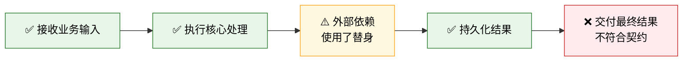

# 验收报告模板

使用以下结构输出便于业务阅读的验收报告。按项目调整名称和深度，不保留没有内容的空章节。

## 1. 结论摘要

使用不超过 200 个汉字直接说明：

- 业务链路是否跑通；
- 当前支持的最高完成等级；
- 主要 Bug 或缺失证据；
- 进入下一环境或发布前还要完成什么。

## 2. 业务链路状态

根据设计文档绘制一张易读的 Mermaid 图。主链路使用业务语言，技术字段放到后续证据章节。



图例：

- ✅ 本轮有新证据，已通过
- ⚠️ 部分通过或使用了替身
- ❌ 失败
- ⏸ 未测试

## 3. 设计验收矩阵

| 设计要求 | 本轮实际操作 | 证据 | 结果 | Bug/业务影响 |
| --- | --- | --- | --- | --- |
| 示例要求 | 实际 API、任务或数据操作 | ID、数据库行、日志、结果文件 | 通过/部分通过/失败/未测试 | 用户和发布影响 |

每项重要产品要求只出现一次。技术证据使用链接或定位信息，不把大段日志复制进表格。

## 4. 缺陷与缺口

### 发布阻断项

| 问题 | 复现方式 | 数据/用户影响 | 建议下一步 |
| --- | --- | --- | --- |

### 非阻断问题

| 问题 | 为什么不阻断 | 后续处理 |
| --- | --- | --- |

### 未测试范围

列出本轮没有新证据的依赖、场景、环境或用户界面，不得描述为已通过。

## 5. 性能基线

先记录拓扑，再记录指标。

| 场景 | 测试拓扑 | 并发 | 请求数/RPS | P50/P95/P99 | 错误/超时 | 门槛 | 结果 |
| --- | --- | ---: | --- | --- | --- | --- | --- |

说明本轮拓扑与目标环境是否可比，以及为什么。

## 6. 实际执行过程与证据

按真实顺序描述，包括失败命令和修正过程：

1. 仓库和 SHA 核对。
2. 数据库迁移和 Schema 验证。
3. 单元、契约和集成测试。
4. 实际服务与跨项目业务链路。
5. 故障注入和边界测试。
6. 性能探测。

每个关键业务样本保留以下追踪链：

```text
runId
├── 上游请求或来源数据
├── 同步记录或事件 ID
├── 队列、任务或 Worker ID
├── 最终持久化记录
└── 最终 API、页面或业务产物
```

## 7. 完成等级和下一门槛

只能选择一个：

- 代码已完成
- 本地验证完成
- test 验证完成
- 可生产发布
- 生产发布完成

随后只列出进入下一等级所需完成的具体事项。
