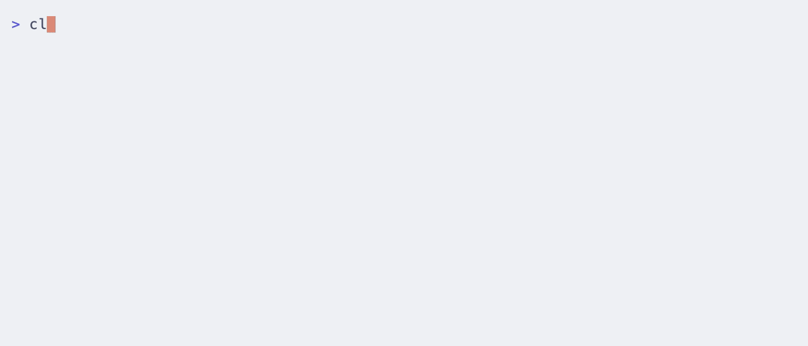

# dbskill

[简体中文](README.md) | [English](README.en.md) | [日本語](README.ja.md) | [한국어](README.ko.md) | 繁體中文

[](VERSION)
[](https://skills.sh/b/dontbesilent2025/dbskill)
[](LICENSE)

**本次更新：** 19 個技能的中文名改成直接說明用途的說法，例如「诊断商业问题」「找前人的解法」「检查内容违规」；標準名和呼叫方式不變

## dbskill 是什麼

dbskill 是 dontbesilent 製作的中文 AI Skills 工具箱，共 34 個 Skill。安裝到豆包、WorkBuddy、Claude Code、Codex 等支援 Skills 的 Agent 後，可以在對話中直接使用。

Skill 是一套寫給 Agent 的做事方法。裝好 dbskill 後，你可以讓 Agent：

- 判斷一門生意的問題出在哪裡，例如續費率低、客戶嫌貴
- 找值得學習的同行，看對方具體怎麼做
- 把一個選題做成內容方案，檢查文稿哪裡沒有打動人
- 為一支影片寫標題、封面文字和開頭，發布前檢查有沒有違規風險
- 分析自己為什麼知道該做，卻一直沒有做
- 把本機資料夾整理成可以隨時查詢的知識庫

方法資料來自 dontbesilent 的 16,152 則公開貼文，整理成 4,176 個知識原子。作者：[@dontbesilent](https://x.com/dontbesilent)

## 快速開始

**第 1 步：安裝**

在終端機執行：

```bash
npx -y skills add dontbesilent2025/dbskill -g --all
```

使用 Claude Code 外掛市集或只安裝單一 Skill，見下文[安裝詳情](#安裝詳情)。

**第 2 步：把問題交給 `/dbs`**

在 Agent 對話框輸入 `/dbs`，後面寫上你的情況和問題。資訊不完整也可以：

```text
/dbs 我做兒童程式設計課，有 40 個付費學員，但續費率很低。我不知道該先檢查產品、定價還是客戶匹配
```

第一次使用時，可以先輸入 `/dbs 新手入门`，了解它能處理哪些任務。

**第 3 步：在同一個對話中繼續**

收到結果後，直接補充事實、材料或修改意見，不用重新輸入命令。換一個新目標時，再輸入一次 `/dbs`。

## /dbs 怎樣安排 Skill

`/dbs` 是 dbskill 的技能調度台。它先看你要的最終結果，再決定用哪幾個 Skill、按什麼順序使用。能少用就少用：簡單問題直接回答，一個 Skill 夠用就只用一個。

常見的安排有 6 種：

1. **只用一個**：診斷商業模式，只用 `dbs-diagnosis`
2. **按順序接著做**：後一步要用到前一步的結果。`dbs-content` 給出創作方案，你寫完文稿，再用 `dbs-content-risk-check` 檢查發布風險
3. **各做各的**：幾件事互不相關。`dbs-ai-check` 檢查 AI 味，`dbs-wechat-html` 排版，兩份結果分別交給你
4. **先判斷，再決定做不做**：`dbs-content-value` 先判斷選題值不值得做，值得再用 `dbs-content` 出方案
5. **分別分析，再比較**：同一個問題可能有幾種原因。文稿流量低，`dbs-content-value` 和 `dbs-resonate` 各自給出原因，`/dbs` 再比較
6. **做完檢查，再修改**：要求高的文字，`dbs-plain-writing` 寫完後用 `dbs-ai-check` 檢查，再按問題修改

需要你決定方向時，`/dbs` 會把選項列給你，不替你選。開始前，它會說明打算怎麼安排、為什麼這樣安排。

## 全部 Skill

已經知道要用哪個 Skill 時，可以直接輸入它的命令。每個 Skill 的適用時機、輸入範例和邊界，見[新手入門與 Skill 全目錄](docs/新手入门.md#skill-全目录)。

### 入口

| 命令 | 用途 |
| --- | --- |
| [`/dbs`](skills/dbs/SKILL.md) | 根據你的問題選擇和安排 Skill，在目前的對話中推進 |

### 商業判斷與問題釐清

| 命令 | 用途 |
| --- | --- |
| [`/dbs-diagnosis`](skills/dbs-diagnosis/SKILL.md) | 判斷一個商業問題是否成立，或全面檢查一門生意，給出明天要做的第一件事 |
| [`/dbs-benchmark`](skills/dbs-benchmark/SKILL.md) | 篩選值得模仿的同行，拆出對方獲客、轉化、交付的具體做法 |
| [`/dbs-jtbd`](skills/dbs-jtbd/SKILL.md) | 分析顧客為什麼選擇或放棄一個產品 |
| [`/dbs-goal`](skills/dbs-goal/SKILL.md) | 把模糊的願望整理成能檢查的目標和完成標準 |
| [`/dbs-good-question`](skills/dbs-good-question/SKILL.md) | 把模糊的問題改寫清楚，判斷哪些部分能交給 Agent |
| [`/dbs-deconstruct`](skills/dbs-deconstruct/SKILL.md) | 拆解一個說不清的概念，講清它在不同場合的意思 |
| [`/dbs-theory-grounding`](skills/dbs-theory-grounding/SKILL.md) | 檢查課程、簡報或方法論中的判斷，找到可信的理論依據 |
| [`/dbs-standard-answer`](skills/dbs-standard-answer/SKILL.md) | 研究一個問題的相關理論和歷史案例，給出帶條件的標準答案 |

### 內容創作與發布

| 命令 | 用途 |
| --- | --- |
| [`/dbs-content`](skills/dbs-content/SKILL.md) | 把已定的選題做成內容方案：形式、平台、結構和表達 |
| [`/dbs-title-cover-intro`](skills/dbs-title-cover-intro/SKILL.md) | 先定選題，再寫小紅書、B 站、抖音、視頻號的標題、封面文字和開頭 |
| [`/dbs-resonate`](skills/dbs-resonate/SKILL.md) | 找出寫好的文稿哪裡沒有打動目標受眾，給出刪改建議 |
| [`/dbs-script-flow`](skills/dbs-script-flow/SKILL.md) | 檢查短影片逐字稿的銜接和口播流暢度，標出觀眾可能滑走的位置 |
| [`/dbs-content-value`](skills/dbs-content-value/SKILL.md) | 判斷內容會吸引誰、開頭能不能留住人，以及可能的流量和商業價值 |
| [`/dbs-spread`](skills/dbs-spread/SKILL.md) | 解釋一則已有反響的內容為什麼讓人共鳴或轉發 |
| [`/dbs-ai-check`](skills/dbs-ai-check/SKILL.md) | 標出文案中的 AI 寫作痕跡 |
| [`/dbs-content-risk-check`](skills/dbs-content-risk-check/SKILL.md) | 發布前逐句檢查平台審核風險，給出最小的修改方法 |
| [`/dbs-plain-writing`](skills/dbs-plain-writing/SKILL.md) | 按事實順序撰寫產品、功能和更新說明，不加行銷包裝 |
| [`/dbs-wechat-html`](skills/dbs-wechat-html/SKILL.md) | 把 Markdown 排成能貼到微信公眾號後台的 HTML |

### 影片處理

| 命令 | 用途 |
| --- | --- |
| [`/dbs-video-extract`](skills/dbs-video-extract/SKILL.md) | 根據平台連結取得作品資料和語音文字稿；需要外部服務憑證 |
| [`/dbs-video-navigation`](skills/dbs-video-navigation/SKILL.md) | 為本機影片劃分章節，產生可匯入剪輯軟體的導航條 |

### 行動、學習與決策

| 命令 | 用途 |
| --- | --- |
| [`/dbs-action`](skills/dbs-action/SKILL.md) | 分析知道該做卻一直沒做的原因，給出今天能做的一步 |
| [`/dbs-learning`](skills/dbs-learning/SKILL.md) | 把一個課題拆成連續的學習文章，依你的回饋調整下一篇 |
| [`/dbs-decision`](skills/dbs-decision/SKILL.md) | 為需要長期追蹤的決策建立本機紀錄，之後回填結果和復盤 |

### 存檔與報告

| 命令 | 用途 |
| --- | --- |
| [`/dbs-save`](skills/dbs-save/SKILL.md) | 把目前對話的結論和下一步儲存到本機 |
| [`/dbs-restore`](skills/dbs-restore/SKILL.md) | 讀取上次的存檔，接著處理 |
| [`/dbs-report`](skills/dbs-report/SKILL.md) | 把多份存檔合併成一份報告 |

### 多視角討論

| 命令 | 用途 |
| --- | --- |
| [`/dbs-chatroom`](skills/dbs-chatroom/SKILL.md) | 請幾位專家角色圍繞一個話題分別發言，最後彙總 |
| [`/dbs-chatroom-austrian`](skills/dbs-chatroom-austrian/SKILL.md) | 用海耶克、米塞斯兩位奧地利學派經濟學家的視角討論問題 |

### 資料與工具

| 命令 | 用途 |
| --- | --- |
| [`/dbs-knowledge`](skills/dbs-knowledge/SKILL.md) | 把本機資料夾建成 Agent 能查找、收錄和維護的知識庫 |
| [`/dbs-content-system`](skills/dbs-content-system/SKILL.md) | 把一批舊文稿整理成可以拆分、重複使用的內容資料庫 |
| [`/dbs-human-dispatch`](skills/dbs-human-dispatch/SKILL.md) | 把任務派給員工或協作者，追蹤進度並驗收結果 |
| [`/dbs-skill-maker`](skills/dbs-skill-maker/SKILL.md) | 製作新的 Skill，或改進已有的 Skill |
| [`/dbs-install-skill`](skills/dbs-install-skill/SKILL.md) | 把 Skill 安裝到多個 Agent，並清理重複的入口 |

## 安裝詳情

以下命令都在終端機執行，不要當作聊天內容發給 Agent。

### Skills CLI

```bash
npx -y skills add dontbesilent2025/dbskill -g --all
```

`-g` 表示全域安裝，`--all` 表示安裝到 Skills CLI 能識別的所有 Agent。只想裝到一個 Agent 時，刪掉 `--all`，依提示選擇。

### Claude Code 外掛市集

```bash
claude plugin marketplace add dontbesilent2025/dbskill
claude plugin install dbs@dontbesilent-skills
```

使用外掛方式時，命令前面要加 `dbs:`，例如 `/dbs:dbs`、`/dbs:dbs-diagnosis`。

只安裝一個 Skill 時，安裝對應的外掛，例如：

```bash
claude plugin install dbs-diagnosis@dontbesilent-skills
```



### 裝好後沒看到命令

先確認安裝命令已執行成功，而且裝到的是你正在使用的 Agent。Skills CLI 安裝使用短命令，例如 `/dbs`；Claude Code 外掛使用帶 `dbs:` 的命令。具體名稱以 Agent 中顯示的為準。

## 更多用法

### 直接呼叫某個 Skill

在命令後寫上問題、材料和你想要的結果：

```text
/dbs-diagnosis 我做收納諮詢，客單價 3,000 元。最近 10 個諮詢中有 6 個說貴，3 個沒有回覆。請判斷下一步先核實什麼
```

```text
/dbs-title-cover-intro 這是準備拍攝的短影片文稿，請按小紅書發布，給我標題、封面文字和開頭：貼上文稿
```

提問時附上這些資訊，結果會更準確：

- 你手上已有的事實和數字，例如價格、人數、成交情況
- 完整的文稿或材料，不要只給摘要
- 你想要什麼結果，例如判斷、方案，還是能直接使用的文字

需要讀取本機檔案、連網或處理影片的 Skill，Agent 還要有相應的權限或工具，具體見各 Skill 的說明。

### 使用影片中的三位數編號

在 dontbesilent 的影片中拿到三位數編號後，輸入：

```text
/dbs 123
```

把 `123` 換成影片給出的編號。想查看目前所有編號，輸入 `/dbs 給我所有隱藏版 Skill`。編號內容在使用時從 GitHub 讀取，Agent 需要能連上 GitHub。

### 跨對話保留結論

用 `/dbs-save` 儲存目前的結論，下次用 `/dbs-restore` 接著處理。存檔儲存在本機 `~/.dbs/`。

## 倉庫資料

安裝 Skill 不會下載這些資料，需要時在倉庫中查閱。

| 資料 | 用途 |
| --- | --- |
| [公開貼文集（Markdown）](books/dontbesilent-开源推文集.md) | 搜尋、閱讀，或交給 AI 分析 |
| [公開貼文集（PDF）](books/dontbesilent-开源推文集.pdf) | 閱讀和保存 |
| [原子庫說明](知识库/原子库/README.md) | 資料範圍、欄位和使用方式 |
| [知識原子資料](知识库/原子库/atoms.jsonl) | 自建檢索、分析或 RAG |
| [Skill 知識包](知识库/Skill知识包) | 依 Skill 整理的方法資料 |

## 更新與說明

在 Agent 對話中說：

```text
更新 dbskill
```

更新會同步官方 dbskill，保留 `~/.dbs/` 中的存檔和紀錄，並自動清理已經下線的舊 Skill。手動清理方法見[新手入門](docs/新手入门.md)。歷史變更見[更新紀錄](https://github.com/dontbesilent2025/dbskill/commits/main)。

- [新手入門與 Skill 全目錄](docs/新手入门.md)
- [提交問題或建議](https://github.com/dontbesilent2025/dbskill/issues)
- [付費問答群說明](https://mp.weixin.qq.com/s/RpwNjMo4M_er4GOrfCYt1g)
- 作者：[@dontbesilent](https://x.com/dontbesilent) · [小紅書](https://xhslink.com/m/637xuspR4iI) · [抖音](https://v.douyin.com/pRUDhpBqOrc/)

## 貢獻者

`dbs-content-risk-check` 的敏感詞檢查能力由以下共創者共同完善：

- [@Ronnie2025](https://github.com/Ronnie2025)
- [@非著名投放小沈](https://xhslink.cn/m/4NSBjmZTC1j)

## 授權條款

本專案採用 [CC BY-NC 4.0](LICENSE) 授權條款。個人學習、研究和非商業使用請註明來源；商業用途請聯絡作者取得授權。
