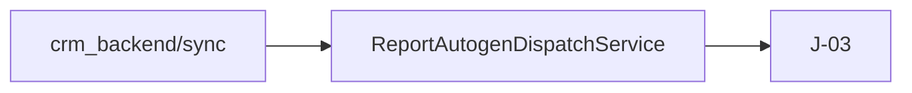
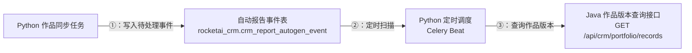

# 从现有代码生成全链路接口文档的可复用提示词

适用于用户只给出一个功能目标，但希望最终得到可供开发、测试、产品和架构评审的完整技术文档。典型要求包括：流程图、所有接口、路由、参数含义、参数来源、数据库、表、字段、Key、索引、SQL、异常、兼容性和测试范围。

## 核心原则

这类任务不是“根据需求写一份看起来合理的方案”，而是：

```text
用户给出功能和边界
→ AI 阅读当前代码和迁移脚本
→ 还原真实参数与数据链路
→ 区分已有、扩展、新增和排除项
→ 冻结接口与数据库契约
→ 补齐异常、兼容、测试和验收
→ 写入可评审的 Markdown 文档
```

代码事实优先于历史文档。历史文档可以帮助定位，但如果与当前代码冲突，必须以当前代码为准，并在文档中指出漂移。

## 面向新成员的底层讲解思路

全链路文档不仅要“信息完整”，还要让一个没有看过代码的新成员能按正确顺序建立系统认知。默认采用两层结构：

```text
第一层：5～10 分钟开发导读
  → 现在系统怎么运行
  → 目前断点或问题在哪里
  → 本阶段改完后是什么样
  → 各系统分别负责什么
  → 核心参数如何从产生位置流到最终页面
  → 新开发应该先看哪里、先改哪里

第二层：可实施的详细契约
  → 每个接口的完整请求、响应和错误
  → 每张表、字段、主键、唯一键和索引
  → 代码入口、实施顺序、异常处理和测试验收
```

推荐认知顺序是：

```text
现状 → 问题 → 目标 → 边界 → 数据血缘 → 接口契约
     → 数据库 Key → 代码位置 → 开发顺序 → 测试验收
```

不要一上来堆 DTO、JSON 和 SQL。新成员如果还不知道当前流程和系统边界，就无法判断一段内容是在描述“已经存在”“准备扩展”还是“未来建议”。

### 30 分钟技术评审版式

当目标明确包含“新人快速上手”“30 分钟内完成技术评审”或“尽可能减少文字”时，默认在同一文档内使用以下版式：

```text
第一部分：30 分钟技术评审
  → 图为主，只保留作出技术决策所需信息

---

开发查询附录
  → 完整接口、数据库、代码和测试细节，按职责查询
```

第一部分建议控制为 5 张左右核心图和少量短表：

1. 目标与阶段边界。
2. 当前旧流程图。
3. 阶段目标新流程图。
4. 旧新流程对比表。
5. 核心 Key 和数据关联图。
6. 简化 ER 图。
7. 数据库改动数量短表：新增几张、修改几张、复用哪些现有表。
8. 分仓改造与依赖图。
9. 已确认方案、上线风险和生产验收三个短表。

第一部分默认不放：

- 完整请求或响应 JSON。
- SQL、DDL 和逐字段表结构。
- 全量错误码和异常分支。
- 大段代码路径、类名和实现说明。
- 逐仓完整测试用例。
- “新成员第一天完成标准”等不直接影响技术决策的管理性内容。

这些信息不是删除，而是统一放到明显分割线后的开发附录。附录开头增加按角色查询导航，并写明“开发、联调和测试时按负责模块查询，不要求顺序阅读全文”。

数据库改动数量属于评审决策信息，不属于可以只放附录的实现细节。只要方案涉及表、字段或索引，评审主文必须增加一张短表，至少列出：

| 类型 | 数据库对象 | 改动 | 数量口径 |
| --- | --- | --- | --- |
| 新增表 | 真实库表名 | 为什么必须新增 | 主仓正式迁移 / 工作树设计 / 待实施 |
| 修改表 | 真实库表名 | 增加字段或索引 | 已存在表 |
| 复用现有表 | 真实库表名 | 只改查询或业务语义 | 不计入新增 |
| 明确不新增 | 候选表或字段 | 为什么不需要 | 防止重复设计 |

统计时必须区分：

1. 当前主仓正式迁移中已经存在什么。
2. 其他功能分支、工作树或历史文档里只是设计或尚未合并什么。
3. 目标生产环境实际执行过什么。

如果无法直接核验生产 schema 或 `flyway_schema_history`，不要给出伪确定数字。应写成“按主仓最多新增 X 张；若生产已存在某表，则实际新增 Y 张”，并在发布前检查项中明确要求核验。

业务理解图和开发契约必须分层：

1. Key 关联图、具体数据流转图使用中文业务含义，不在每个节点重复英文变量名。
2. 英文变量集中到一张“中文含义 / 开发字段 / 用途”对照表。
3. 示例链路不重复倾倒长 Hash、数据库行、字段赋值和响应 JSON；详细值只在接口与数据库章节出现。
4. 附录先删除与正文重复的旧新流程、范围、结论、架构、排期、代码依据和阶段预留，再考虑缩减接口契约。
5. 全新接口保留完整契约；已有接口扩展优先只写变化字段，除非文档必须完全自包含。

推荐评审节奏：

| 时间 | 只看什么 |
| --- | --- |
| 0～3 分钟 | 目标和阶段边界 |
| 3～9 分钟 | 旧流程和当前断点 |
| 9～16 分钟 | 新流程和旧新对比 |
| 16～21 分钟 | 核心 Key 与数据库关系 |
| 21～26 分钟 | 分仓改造和开发依赖 |
| 26～30 分钟 | 风险、待确认项和验收结论 |

不要以总行数作为唯一质量指标，但评审主文应能独立完成讨论和决策。详细内容再长，也不能反向侵入第一阅读路径。

### 一张图只回答一个问题

不要试图用一张超大时序图同时表达系统拓扑、当前流程、目标流程、数据库关系、异常分支和开发顺序。参与者超过 4～5 个、同时包含写入和读取、或出现多个 `alt` 分支时，应拆图。

不同视图分别回答：

| 视图 | 只回答什么问题 |
| --- | --- |
| 当前流程图 | 今天代码真实怎样运行，断点在哪里 |
| 目标架构图 | 改完后系统如何分工 |
| 写入时序图 | 参数按什么时间顺序产生、传递和落库 |
| 读取时序图 | 页面怎样查询、聚合和展示数据 |
| ER 图 | 表通过哪些主键、唯一键和逻辑外键关联 |
| 开发依赖图 | 哪些工作先做，哪些可以并行，在哪里联调 |

图不是越多越好。正文优先保留“当前流程、目标总览、写入、读取”四张核心图；ER 图、状态图和开发依赖图放在对应详细章节。每张图后继续提供表格或列表兜底。

### 图里写业务含义，表里保留接口编号

新成员首先需要理解“谁在做什么”，而不是记住文档内部编号。Mermaid 默认遵守以下分层：

1. 节点使用中文业务动作，例如“Python 作品同步任务”“扫描待处理事件”“创建总结版学情报告任务”。
2. 不用类名、模块路径、DTO 名或 `J-01/J-02/P-01` 作为 Mermaid 主标签。
3. 接口节点直接显示业务名称、HTTP 方法和真实路由，例如“七牛云上传签发接口 + `POST /api/portfolio/qiniu/presign`”。
4. 数据节点直接显示中文用途和真实库表，例如“写入自动报告事件表 + `rocketai_crm.crm_report_autogen_event`”。
5. 接口编号仍保留在接口总表、详细接口标题和交叉引用中，方便开发全文检索。
6. `graph`/`flowchart` 的显式步骤统一写成 `①：②：③：…`；超过 20 步拆图。`sequenceDiagram` 默认使用 `autonumber`，不重复手写圈号。

不要写成：



应写成：



### 图里的运行方式必须来自真实代码

不要把所有后台行为笼统写成“Python 定时任务”或“后端处理”。应先从代码、配置和部署入口确认：

- 谁负责定时触发，例如 Cron、Celery Beat、Quartz 或平台调度器。
- 谁真正执行异步工作，例如 Celery Worker、消息消费者或线程池。
- 哪一步只创建任务记录，哪一步真正生成内容，哪一步更新最终状态。
- 事件表、任务表和业务结果表是否是同一张表。
- 调用链是否经过 BFF、Python、Java 或第三方服务，不能为了图简单而跨越真实服务边界。

图中用中文解释这些组件的职责，同时保留代码中的真实组件名。例如写成“Python 定时调度（Celery Beat）→ 异步任务执行器（Celery Worker）”，而不是只写一个模糊的“Python 后台”。

### 用数据血缘贯穿全文

复杂系统的稳定讲解主线不是服务名称，而是关键数据。对每个核心参数必须连续回答：

```text
谁产生 → 谁传递 → 谁校验 → 存在哪里 → 用什么 Key 查询
       → 谁聚合 → 最终谁消费 → 出错时如何定位
```

接口、数据库和代码章节应使用相同字段名称和接口编号，让读者可以从一个页面字段反向追到 API、Service、Repository、表和索引。Mermaid 图使用业务名称和真实路由，接口总表与详细章节再使用统一接口编号。

### 详细但不重复

总览表负责快速定位，详细接口章节负责完整契约。总览表通过接口编号指向详细章节，不要在多个章节重复粘贴同一大段 JSON。新增内容优先补“导航和追踪关系”，而不是继续堆相同细节。

## 最小触发语

用户不想填写模板时，只需要说：

```text
请基于当前代码，梳理【功能名称】的完整全链路文档。

需要包含流程图、涉及的全部接口，以及每个接口的完整讲解：调用方、路由、请求方式、参数来源、参数含义、校验、响应、错误码、会查询或写入哪个数据库、哪张表、哪些字段、具体使用什么 Key 和索引。

请区分当前已经存在的能力、需要扩展的能力、全新能力和本阶段明确不做的内容，并补充历史数据兼容、幂等、并发、失败重试、性能、安全、代码改动范围、测试范围和生产验收条件。

不要只根据旧文档推测，先探索当前代码。除非存在无法从代码确认且会改变方案的阻塞问题，否则直接完成调研并写成 Markdown 文档，不要只给提纲。
```

命中本 reference 后，即使用户只说“流程图 + 接口 + 数据库表和 Key”，也应自动补齐上述深度，不要求用户重复背诵完整模板。

## 完整提示词模板

下面的内容可以跨项目直接复制。方括号内容按实际情况填写，未知项可以留空，由 AI 先从工作区发现。

````text
你现在要基于当前工作区的真实代码，为一个具体功能生成可直接用于技术评审、开发联调和测试验收的全链路接口文档。

# 一、任务输入

功能名称：【填写功能名称】
本次阶段：【例如：阶段 1，只做录音和 H5】
业务背景：【填写为什么要做】
涉及项目：【可选；不知道就由你从工作区发现】
明确包含：【本阶段必须交付什么】
明确排除：【本阶段绝对不做什么】
已确认决策：【例如：使用 Hash 关联；不传 userId】
目标读者：【默认：没看过代码的技术负责人、开发、测试和产品经理】
期望保存位置：【可选；未填写时遵循项目文档规范】

# 二、工作方式

1. 先阅读工作区和各子项目的协作规则、文档规范、数据库规范。
2. 先检查当前仓库和分支状态，不覆盖用户已有改动。
3. 使用代码搜索定位前端入口、请求封装、Controller/Router、DTO/Schema、Service、Repository/Mapper、Entity/Model、数据库迁移、配置、安全白名单和测试。
4. 以当前代码为事实源。历史文档只用于辅助定位；发现文档与代码不一致时，明确写出“当前代码事实”和“旧文档差异”。
5. 不要凭经验编造路由、字段、表名、索引或错误码。无法验证的内容标记为“待确认”或“建议契约”。
6. 先完成代码调研，再提出问题。只有无法从代码确认、且答案会实质改变方案时才向用户提问；其余情况采用保守假设并显式记录。
7. 默认只输出调研和文档，不修改业务代码、数据库迁移或配置，除非用户明确要求实施。
8. 不要停在提纲或方案建议，完成文档写入、索引更新和格式验证。

# 三、必须还原的真实链路

从用户动作开始，一直追到最终展示或数据消费：

- 先单独还原“改造前的当前流程”，只画当前代码真实存在的节点，不把建议能力提前画进去。
- 再列出当前流程中的明确断点，并逐项映射到本阶段改造。
- 最后画“本阶段目标流程”，让读者可以直接比较改造前后差异。

- 参数最初从哪里产生：URL、路由、登录态、App Bridge、表单、配置、后端返回或第三方系统。
- 前端把哪些参数传给哪个接口。
- 后端 DTO/Schema 如何接收和校验。
- Service 如何转换、补全或覆盖参数。
- Repository/Mapper 最终查询或写入什么库表。
- 查询使用什么字段、主键、唯一键、联合索引和排序规则。
- 数据写入后，后续系统如何读取、聚合并返回前端。
- 页面如何根据响应决定显示、隐藏、排序、播放或降级。
- 如果经过对象存储、消息队列、异步任务或第三方接口，明确区分“签发成功”“上传成功”“处理成功”和“业务落库成功”。

为关键参数建立来源追踪表：

| 参数 | 产生位置 | 前端字段 | 接口字段 | 后端对象 | 数据库列/查询 Key | 最终用途 |
| --- | --- | --- | --- | --- | --- | --- |

在详细接口前，再给一张跨系统总表，直接回答“拿什么参数、查什么库表、用什么 Key、最后得到什么”：

| 步骤 | 调用方 -> 服务 | 接口编号与路由 | 主要输入 | 数据库/表 | 查询或写入 Key | 主要输出 | 当前状态 |
| --- | --- | --- | --- | --- | --- | --- | --- |

# 四、文档必须区分四种状态

对每项能力、接口、字段和表明确标注：

- `现有`：当前代码已经真实存在。
- `现有扩展`：保留接口或表，只新增字段或行为。
- `阶段新增`：当前没有，本阶段需要创建。
- `本阶段排除`：以后可能需要，但本阶段不能混入。

不能把“建议新增”写成“当前已经存在”，也不能把未来阶段内容混进本阶段工作量。

# 五、必须输出的图

至少提供：

1. 一张当前流程图：当前参数、接口、数据库和最终页面如何工作，缺失能力在哪里。
2. 一张目标总体架构图：前端、后端、数据库、对象存储、第三方服务之间的关系。
3. 一张写入链路时序图：从用户动作到最终落库。
4. 一张读取链路时序图：从页面查询到数据聚合和展示；单对象和聚合对象可以用一个清晰的 `alt` 分支表达，过宽则拆图。
5. 一张 ER 图：只画本功能直接涉及的表、主键、唯一键和逻辑关系。
6. 如果涉及播放、任务或页面状态，再增加 `stateDiagram-v2`。
7. 如果涉及多人或多仓并行开发，再增加一张开发依赖图，标出前置契约、并行区和联调点。

使用简单稳定的 Mermaid：优先 `graph LR`、`sequenceDiagram`、`erDiagram` 和 `stateDiagram-v2`。图后必须有普通表格或列表兜底。

不要使用一张“大而全”的时序图。一个时序图默认只描述一种主目的：写入或读取。只有参与者少、没有复杂分支且确实更易读时，才允许合并。

Mermaid 节点和连线标签不能以 `1.`、`2.`、`- `、`* `、`+ ` 等 Markdown 列表语法开头，否则部分渲染器会显示 `Unsupported markdown: list`。`graph`/`flowchart` 的显式编号统一使用 `①：②：③：…`；`sequenceDiagram` 使用 `autonumber`。

# 六、接口总表

先给出接口总览：

| 编号 | 调用方 -> 服务 | 方法与路由 | 当前状态 | 本阶段用途 | 是否阻塞上线 |
| --- | --- | --- | --- | --- | --- |

前端已经调用、但后端当前没有实现的路由，必须明确标记为“当前缺失的上线阻塞项”。

## 用一个黄金样例验证整条链路

接口总表后选择一个最典型的业务对象，给出一套经过脱敏但前后一致的示例值，从起点追踪到终点：

```text
用户动作和初始参数
  → 第一个接口请求与响应
  → 核心定位 Key
  → 数据库父记录和子记录
  → 后续服务查询参数
  → 最终页面响应字段
```

黄金样例中的 `userId/hash/reportId/slotIndex` 等值在全文保持一致。它不是替代接口契约，而是用来暴露字段歧义、关联断裂和前后示例不一致。

# 七、每个接口必须完整展开

每个接口都必须包含以下内容，不能只给一个 JSON 示例：

## 接口身份

- 接口编号和名称。
- 当前状态：现有、扩展或新增。
- HTTP 方法和完整路由。
- Base URL 或环境差异；未知时明确写占位符。
- 调用方、被调用方和调用时机。
- 浏览器接口、内部服务接口还是第三方动态地址。
- 鉴权、网关、白名单、限流和调用来源约束。

## 请求契约

- Header、Path、Query、Body 分开说明。
- 每个字段的 JSON 名、后端字段名、类型、是否必填、长度、格式、取值范围和默认值。
- 每个字段由谁产生，调用方是否可信，后端以哪个事实源为准。
- 给出完整请求示例。

## 响应契约

- 外层响应包结构。
- 每个响应字段的类型、空值语义、排序规则和业务含义。
- 给出完整成功响应示例。
- 明确“字段缺失”“null”“空字符串”和空数组 `[]` 分别表示什么。

## 数据库动作

- 数据库/schema 名称。
- 表名和表职责。
- 查询或写入的具体列。
- 主键、唯一键、联合索引和逻辑删除条件。
- 查询排序和最新版本规则。
- 给出等价 SQL 或伪 SQL。
- 说明为什么选择该 Key，以及是否会导致全表扫描或 N+1 查询。

## 一致性与失败

- 幂等键和重复请求行为。
- 并发写入、事务边界和唯一键冲突处理。
- 异步落库竞态和前端/调用方重试策略。
- 稳定 HTTP 状态码、业务错误码、是否重试和重试间隔。
- 下游不可用时是整体失败还是正文成功、附加能力降级。

# 八、数据库章节

对每张相关表输出：

- 数据库和完整表名。
- 当前表还是建议新表。
- 每一列的类型、默认值、是否可空和业务含义。
- `PRIMARY KEY`、`UNIQUE KEY`、普通索引和联合索引的精确列顺序。
- 表之间通过什么字段关联，是物理外键还是逻辑关联。
- 为什么某些字段不重复保存，避免哪类数据漂移。
- 历史数据是否回填；不回填时查询如何自然返回空结果。
- 当前迁移脚本、实体模型和生产表结构是否可能不一致。
- 字段长度是否足够，尤其检查 URL、JSON、Hash 和错误信息字段。

数据库图和表格之后，补一张“数据从哪里来、最终存到哪里”的追踪表。

# 九、兼容性和历史数据

必须回答：

- 历史记录缺少新增字段时会发生什么。
- 是否需要批量回填；如果不需要，为什么。
- 能否使用同一套通用查询，而不是维护新旧两套接口或 SQL。
- 是否需要类似 `includeX=true` 的参数；如果前端事先不知道有没有数据，默认查询是否更合理。
- 新增字段是否改变现有幂等键、版本规则、报告正文或旧页面。
- 同一对象重新提交时是新增版本、覆盖槽位还是拒绝。

# 十、代码改动范围

按仓库或服务分别列出：

| 项目/模块 | 当前职责 | 需要改动 | 关键文件或类 | 难度/风险 |
| --- | --- | --- | --- | --- |

文件位置必须来自实际搜索结果。使用项目相对路径，避免把个人机器绝对路径写进仓库文档。

对新成员额外提供“代码入口地图”，至少定位到：

```text
仓库
  → 页面或调用入口
  → 请求 Client
  → Controller / Router
  → DTO / Schema
  → Service
  → Repository / Mapper
  → Entity / Model
  → 迁移脚本
  → 对应测试
```

如果当前存在废弃服务、旧调用方、临时跨库读取或历史兼容模块，要明确写出“仍在运行、仅供参考、禁止继续扩展或已经废弃”，避免新成员误改旧链路。

## 开发顺序和并行关系

详细文件清单之外，还必须给出实施顺序：

1. 哪些跨仓字段、路由和空值语义必须先冻结。
2. 哪些数据库和基础接口是下游前置依赖。
3. 哪些模块可以基于 Mock 并行开发。
4. 第一次契约联调发生在哪里。
5. 第一次真实数据端到端联调发生在哪里。
6. 哪些测试必须在合并前完成，哪些必须在生产环境验收。

多人开发时用依赖图或表格表示，不要只给一串无法并行判断的 ToDoList。

## 已确认决策与待确认项

在开发清单前集中列出：

| 主题 | 状态 | 当前结论或选项 | 不确认会影响什么 | 最晚确认节点 |
| --- | --- | --- | --- | --- |

已确认决策不应在后文再次写成开放问题。无法从代码确认且会改变数据库、接口或上线方式的事项必须进入待确认表，不能藏在某个接口备注中。

# 十一、安全和性能

至少评估：

- URL 协议、精确域名白名单、长度和重定向风险。
- Hash、token、userId 等字段是不是定位键或权限凭证，不能混淆。
- 内部接口是否可能因为通配白名单暴露公网。
- 一次写入和一次读取分别包含多少次数据库查询与远程调用。
- 是否命中唯一索引，是否存在 N+1、全表扫描或重复跨服务调用。
- 当前阶段是否需要缓存、分库分表或异步化；不需要时明确说明原因。

# 十二、测试和生产验收

分别列出：

- 前端单元/组件测试。
- Java、Go 或 Python 单元测试。
- MySQL 集成测试和唯一键并发测试。
- 跨服务接口契约测试。
- 端到端测试。
- 历史数据回归测试。
- 降级、超时、重试和错误码测试。
- 真机、浏览器、H5、PDF 或第三方环境验收。
- 生产冒烟与上线门槛。

每个测试项写清楚“输入场景”和“预期结果”，不要只写“测试接口”。

# 十三、推荐文档结构

文档默认分成“新成员导读、详细接口契约、实施与验收”三部分。可根据功能删减，但不能丢失接口和数据库细节。

### 第一部分：新成员 5～10 分钟导读

1. 这次到底要解决什么问题。
2. 本阶段包含与明确排除。
3. 当前系统真实流程图。
4. 当前断点与本阶段改造映射。
5. 阶段目标总览图和系统职责。
6. 核心标识、参数来源和数据血缘。
7. 接口与数据库跨系统总表。
8. 黄金样例完整追踪。
9. 代码入口地图、开发顺序和并行关系。
10. 已确认决策、待确认项和上线阻塞项。

如果用户要求 30 分钟技术评审或图为主，将本部分升级为“30 分钟技术评审主文”：保留 5 张左右核心图和必要短表，然后使用 `---` 与“开发查询附录”明显分隔。接口 JSON、SQL、索引、代码入口和完整测试直接进入附录。

### 第二部分：详细接口和数据契约

11. 写入完整流程和时序图。
12. 读取完整流程和时序图。
13. 接口总表。
14. 各服务接口完整文档。
15. 页面路由和交互规则。
16. 数据库、表、字段、Key 和 ER 图。
17. 数据来源与最终落点。
18. 幂等、一致性、异常和降级。
19. 安全与性能。

### 第三部分：实施和验证

20. 分仓代码改动范围。
21. 测试清单和联调检查点。
22. 生产验收门槛。
23. 本阶段排除和未来预留。
24. 当前代码依据和历史文档差异。
25. 接口冻结结论。

详细内容很长时，不要删除细节；在文档前面增加导读层，或拆成“开发导读 + 详细接口手册”两篇互相链接的文档。

# 十四、质量红线

- 不写只有架构名词、没有具体路由和 Key 的空泛方案。
- 不用旧文档替代当前代码核对。
- 不把预签名成功写成文件上传成功。
- 不让前端重复传后端已经可以通过唯一 Key 找到的归属字段，除非有明确鉴权需求。
- 不因为历史数据为空就新增一套历史接口。
- 不把动态数量写死成 4、10 或 100，除非产品明确限制。
- 不在循环中逐项调用下游接口；优先批量接口，避免 N+1。
- 不把建议字段、建议表或建议错误码描述成已经存在。
- 不掩盖当前代码中的字段复用、列长度不足、安全白名单或前后端路由不匹配。
- 不在未获得用户要求时直接修改业务代码。

# 十五、最终交付

1. 按项目命名规范写入 Markdown 文件。
2. 更新对应文档索引。
3. 校验 Markdown 代码块闭合、Mermaid 标签兼容和相对链接。
4. 最终回复提供文档链接，并用 1 至 3 句话指出最重要的代码发现和上线风险。
````

## 输出质量自检

交付前逐项确认：

- [ ] 已读取当前代码，而不是只总结用户描述。
- [ ] 已单独还原改造前的当前流程，没有把建议能力画成现状。
- [ ] 主流程文字已优先转换为 Mermaid，没有保留冗长的箭头文字串。
- [ ] `graph`/`flowchart` 的显式步骤使用 `①：②：③：…`，超过 20 步已拆图。
- [ ] Mermaid 使用中文业务动作，并直接显示必要的真实路由、数据库和表名。
- [ ] Mermaid 没有用 `J-01/P-01`、类名或模块路径代替业务含义；接口编号只出现在总表和详细章节。
- [ ] 定时调度、异步 Worker、队列和跨服务调用边界与当前代码一致。
- [ ] 文档前部能让新成员在 5～10 分钟内理解问题、边界、系统分工和起始代码位置。
- [ ] 如果目标是 30 分钟技术评审，文档已拆成“图为主的评审主文 + 明显分隔的开发查询附录”。
- [ ] 评审主文没有完整 JSON、SQL、逐字段接口说明和大段代码路径。
- [ ] 接口、数据库、异常和测试细节没有丢失，已移动到附录并提供按职责查询导航。
- [ ] 首读区没有重复的结论、架构图、阅读说明或不影响技术决策的管理性内容。
- [ ] 已列出所有直接使用的接口，而不是只写新增接口。
- [ ] 已有一张总表直接回答每一步拿什么参数、查什么库表、使用什么 Key、得到什么结果。
- [ ] 每个接口都有方法、路由、调用方、参数、响应、错误和数据库动作。
- [ ] 关键参数能从产生位置一路追到数据库列或最终页面。
- [ ] 已提供一个前后一致的黄金样例贯穿请求、数据库行和页面响应。
- [ ] 每张表都有主键、唯一键、索引及关联说明。
- [ ] 已区分现有、扩展、新增和排除项。
- [ ] 已集中列出已确认决策、待确认项和上线阻塞项。
- [ ] 已给出代码入口地图、开发前置依赖、并行区和联调点。
- [ ] 历史数据和空数据语义明确。
- [ ] 幂等、异步竞态、重试、降级和并发行为明确。
- [ ] 没有 N+1 查询或逐项跨服务调用而未说明。
- [ ] 测试项包含输入与预期结果。
- [ ] Mermaid 标签没有触发 Markdown 列表解析。
- [ ] 文档已写入正确目录并更新索引。

## 为什么这个提示词有效

用户最初的一句话已经定义了交付结果，但没有规定 AI 如何获得事实，也没有约束输出深度。这个模板补的是“调查过程”和“完成标准”：

- 用当前代码约束真实性。
- 用参数追踪和数据库 Key 约束完整性。
- 用现有/扩展/新增/排除约束范围。
- 用异常、历史、测试和验收约束可实施性。
- 用固定文档结构降低跨项目和跨团队沟通成本。

因此用户以后仍可以只说最小触发语，不必每次重复完整模板；只有阶段边界和已确认决策需要按当前任务补充。
