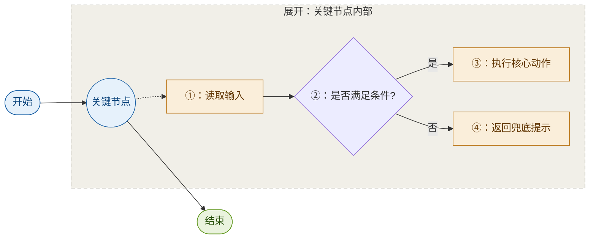
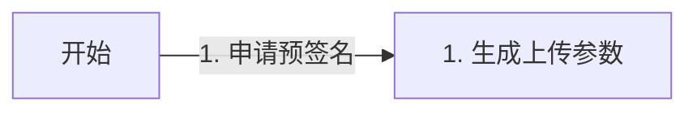
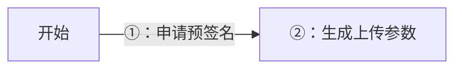

# JC Markdown Visual Writer

用图讲清复杂内容，但**只维护一种图形语言**：主线 + 细节展开。其余图型一律用原生样式，不另立体系。

## 载体判定

| 图的去向 | 用什么 |
|---|---|
| Markdown 文档 / README / 知识库 / issue | 本 skill（Mermaid、ASCII、表格） |
| 对话内联图 / 独立 HTML 页面 | 转 `wb-visualizer-guide` |

判据只有一句：**这张图会离开当前对话吗？** 会 → Mermaid；不会 → SVG。两者不是精度差异，是「谁掌握渲染控制权」的差异，详见 `wb-visualizer-guide` 的载体分流文档。

## 唯一图形语言：主线 + 细节展开

主线给所有人看，细节盒子给需要下钻的人看。同一张图里，宏观与微观分开，不必二选一。

四步：

1. 用 `graph LR` 搭主线，只放核心业务节点。
2. 用 `subgraph` 建细节盒子。
3. 细节盒子内部 `direction TB`，从上到下展开。
4. 用 `-.->` 从主线关键节点连到细节盒子，表示「这里可以展开看」。

使用标准：

- 主线节点 4-8 个字，先让人看懂「整体发生了什么」。
- 一张图**只展开一个**关键节点。要展开第二个，说明该拆图了。
- 主线上的连线必须写真实中文条件：`通过`、`失败`、`库存 > 0`、`语气生硬`。
- 细节盒子里可以用 `①②③` 标顺序（规则见「兼容性红线」）。

通用模板：

配色语义固定：**蓝 = 主线，黄 = 细节，绿 = 结果**。技术图可以把中间件、数据库单独着色，见 `references/mermaid-patterns.md`。

## 视觉标准（对齐 WorkBuddy 九色系）

七个语义角色，每组三值 `填充 / 描边 / 文字`：

| 语义 | 色系 | 填充 | 描边 | 文字 |
|---|---|---|---|---|
| 中性 / 默认 | gray | `#F1EFE8` | `#5F5E5A` | `#444441` |
| 主线 / 动作 | blue | `#E6F1FB` | `#185FA5` | `#0C447C` |
| 细节 / 判断 | amber | `#FAEEDA` | `#BA7517` | `#633806` |
| 结果 / 成功 | green | `#EAF3DE` | `#639922` | `#27500A` |
| 风险 / 边界 | red | `#FCEBEB` | `#A32D2D` | `#791F1F` |
| AI / 中间件 | purple | `#EEEDFE` | `#534AB7` | `#3C3489` |
| 外部系统 / DB | coral | `#FAECE7` | `#D85A30` | `#712B13` |

**配色预算**：主线 1 色 + 细节 1 色 + 结果 1 色 = 3 个。技术图要区分中间件和数据库时，用这两个领域色替换细节色，总数不超过 4 个。备注、参数、注意事项**不加色**——用虚线描边 + 中性文字，靠「轻」区分层级，不靠色相。

规格换算（WorkBuddy 是 680px 定宽画布，Mermaid 输出尺寸不定，不能直接照抄数值）：

| WorkBuddy | Mermaid 落地 | 原因 |
|---|---|---|
| 描边 0.5px | 节点 `stroke-width:1px` | 0.5px 在不定尺寸下细到看不见 |
| 箭头 1.5px | `linkStyle` 1.5px | 可直接一致 |
| 字重仅 400/500 | classDef 不写 `font-weight`，强调用 500 | 禁用 700 |
| 单图 ≤2 色系 | 文档图 ≤3（技术图 ≤4） | 文档一处并列语义更多，2 色装不下主线/细节/结果 |
| 盒内副标题 ≤5 词 | 主线节点 4-8 字 | 同一约束的两种表达 |
| 12px 圆角 | Mermaid 默认 | 不可控，不必强求 |

完整色系、7 阶用法与深色模式取值见 `wb-visualizer-guide`。

## 其他图型：用原生样式

不维护第二套设计体系。下列图型出现时，**一律用 Mermaid 原生样式**，需要颜色时只从上面 7 个角色里取，不另配色。

| 图型 | 何时用 | 样式 |
|---|---|---|
| `sequenceDiagram` | 多角色来回调用 | 原生；只有跨团队/跨系统边界才用 `box` 分组，只有异常阶段才用 `rect` |
| `stateDiagram-v2` | 状态机 | 中性为底；关键状态可按语义加色，开始/结束伪状态保持默认 |
| `erDiagram` | 表、实体、字段 | 默认不加色；不按表数量逐表染色 |
| `pie` | 占比，类目 ≤6 | 用渲染器默认色盘，不复用流程语义色 |
| 纯分支树 | 一个节点扇出多个结果 | `graph LR`，只用蓝主线 + 灰分支，不加第三色 |

不主动使用 `mindmap`、`classDiagram`、`gantt`、`journey`、`quadrantChart`、`gitGraph`、`architecture`、`block` 等高级图种，除非用户点名或材料强烈需要。

只需要层级结构、没有流转关系时，用 ASCII 树或普通列表，不画图。

## 改已有图前先过门禁

1. **现有图有颜色在承担含义**（区分角色、系统、阶段、层级）→ 完全不动。哪怕它和本文档风格不一致，也不擅自柔化配色、减弱描边、重画结构。
2. **删掉颜色还能读懂吗？** 能 → 不必加色。默认黑白且颜色确实能区分动作/判断/边界/结果 → 可以加。
3. **用户只要求「视觉优化」吗？** 是 → 只动颜色、描边、连线样式，节点、文案、顺序、方向、拓扑一律不变。拆图、合并、压文案属于结构优化，必须有明确要求或可指出的阅读障碍。
4. 图已经清楚时，结论就写「保持原样」。不为了展示能力造一张优化版。

## 兼容性红线

部分 Markdown-aware Mermaid 渲染器会继续解析标签里的 Markdown。标签以 `1.`、`2.`、`- `、`* `、`+ ` 开头时会被当列表，显示 `Unsupported markdown: list`。

错误：

正确：

交付前检查 `[...]`、`{...}`、`(...)`、`|...|` 里有没有「数字 + 句点 + 空格」或项目符号开头。序号统一用 `①②③ … ⑳`，超过 20 步拆图。`sequenceDiagram` 用 `autonumber`，不再叠加圈号。`graph`/`flowchart` 里不要用小写 `end` 做节点 ID。

## 文档结构：同一思想的另一个尺度

「主线 + 细节展开」放在文档层面，就是双层结构：

- **第一部分**：以图为主，只留目标与边界、当前流程、目标流程、新旧对比、关键数据关系、核心决策、风险与验收结论。
- **第二部分**：`---` 之后放开发查询附录，收接口、JSON、SQL、字段、错误码、代码位置，开头给按角色的查询导航，注明不要求顺序阅读。

决策者读第一层，实施者查第二层。细节不进第一阅读路径——和细节盒子不进主线是同一条原则。

## 输出习惯

- 一张图只回答一个问题。不要用一张超大图同时承载现状、目标、数据库、异常和排期。
- 图前只写一句它解释什么，图后补关键规则。
- 主线节点短，细节放列表或细节盒子。
- 列表超过 4 层改用 ASCII 树。
- 节点文字沿用材料里的原词，不改术语、不加 emoji。
- Mermaid 代码块里只放 Mermaid，不混解释文字。
- 有可核对的实现（代码、报文、日志）时，图不能替代证据。先给原始制品，再用图压缩关系，最后指回制品位置。

## 资源路由

- 主线 + 细节展开、色板、classDef、其他图型速查 → `references/mermaid-patterns.md`
- ASCII 树、列表、表格、检查清单 → `references/text-structures.md`
- 需要 SVG / HTML / Chart.js 级别的渲染控制 → `wb-visualizer-guide`
- 任务来自 `jc-knowledge-capture`：先遵循它的保存与命名规则，再优化表达
- 任务来自 `jc-plain-explainer`：先遵循它的讲解顺序与真实性规则，本 skill 只负责选视觉结构
