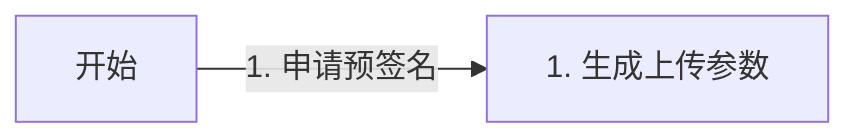
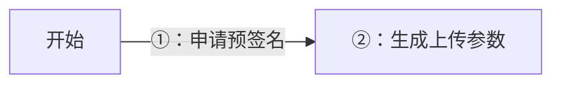
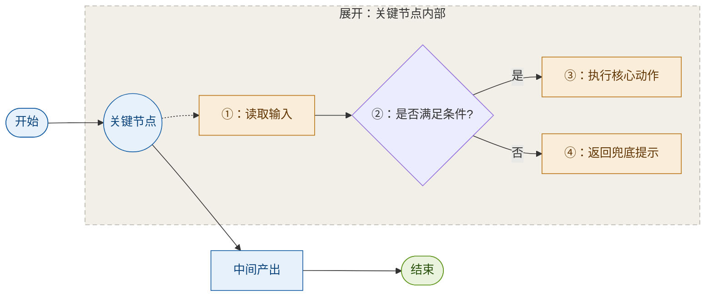
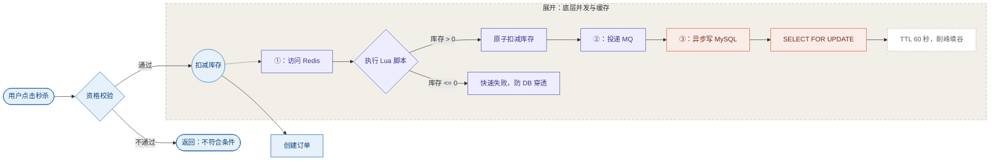
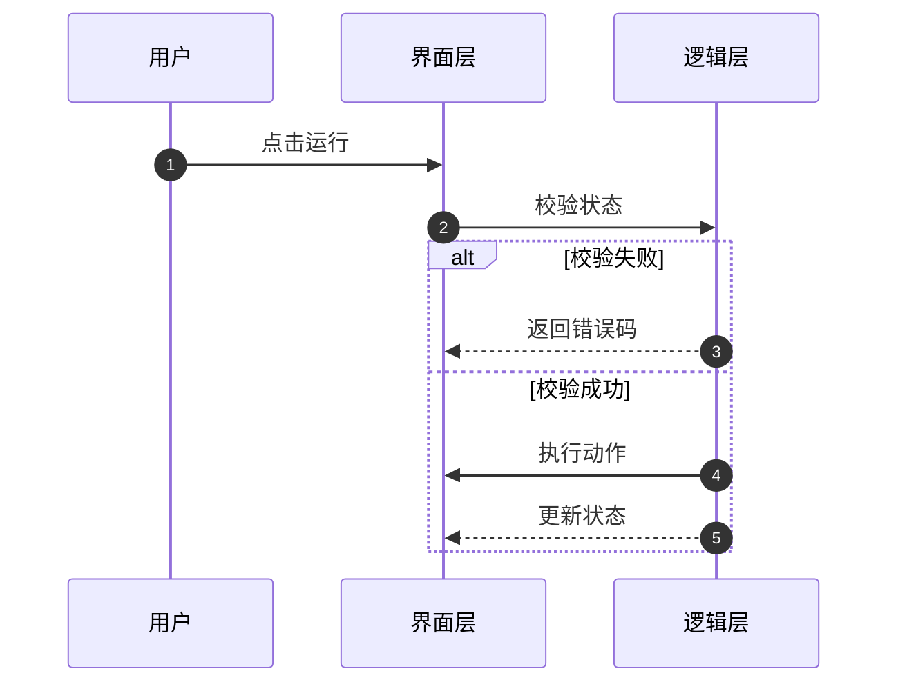
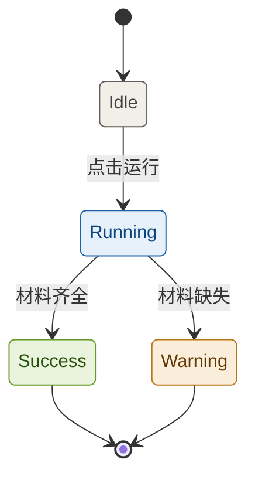
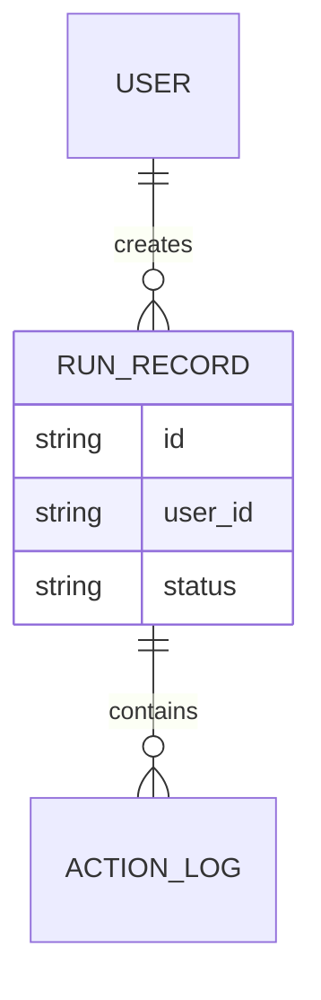
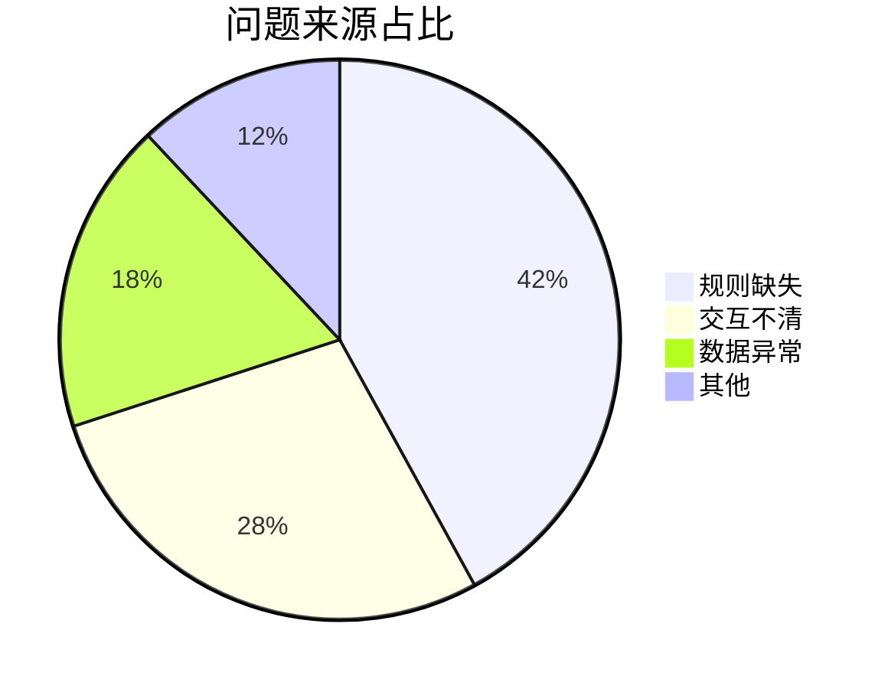

# Mermaid 模板（WorkBuddy 九色系标准）

只保留一种图形语言：主线 + 细节展开。其余图型用原生样式，不另立配色体系。

## 0. 兼容性红线

部分 Markdown-aware Mermaid 渲染器会继续解析标签里的 Markdown。标签以 `1.`、`2.`、`- `、`* `、`+ ` 开头时会被当成列表，渲染出 `Unsupported markdown: list`。



改成：



检查清单：

- 节点标签 `[...]`、`{...}`、`(...)`
- 连线标签 `|...|`、`-- 文字 -->`
- 序号统一 `①②③ … ⑳`，超过 20 步拆图
- `sequenceDiagram` 用 `autonumber`，不再手写圈号
- `graph`/`flowchart` 不用小写 `end` 做节点 ID
- 普通 Markdown 正文的有序列表不受影响

## 1. 色板与 classDef

### 七个语义角色

| 语义 | 色系 | 填充 (50) | 描边 (600) | 文字 (800) |
|---|---|---|---|---|
| 中性 / 默认 | gray | `#F1EFE8` | `#5F5E5A` | `#444441` |
| 主线 / 动作 | blue | `#E6F1FB` | `#185FA5` | `#0C447C` |
| 细节 / 判断 | amber | `#FAEEDA` | `#BA7517` | `#633806` |
| 结果 / 成功 | green | `#EAF3DE` | `#639922` | `#27500A` |
| 风险 / 边界 | red | `#FCEBEB` | `#A32D2D` | `#791F1F` |
| AI / 中间件 | purple | `#EEEDFE` | `#534AB7` | `#3C3489` |
| 外部系统 / DB | coral | `#FAECE7` | `#D85A30` | `#712B13` |

取自 WorkBuddy 九色系的 50 / 600 / 800 三阶。阶位有语义：50 是最浅填充、600 是强调描边、800 是浅底上的文字。不要拿 400 或 900 来凑第三档。

### 基础三色

```mermaid
classDef mainLine fill:#E6F1FB,stroke:#185FA5,color:#0C447C;
classDef detail   fill:#FAEEDA,stroke:#BA7517,color:#633806;
classDef result   fill:#EAF3DE,stroke:#639922,color:#27500A;
classDef neutral  fill:#F1EFE8,stroke:#5F5E5A,color:#444441;
linkStyle default stroke:#B4B2A9,stroke-width:1.5px;
```

### 技术图扩展

```mermaid
classDef middleware fill:#EEEDFE,stroke:#534AB7,color:#3C3489;
classDef external   fill:#FAECE7,stroke:#D85A30,color:#712B13;
classDef note       fill:#FFFFFF,stroke:#B4B2A9,color:#5F5E5A,stroke-dasharray: 4 3;
```

### 使用纪律

- **配色预算**：主线 1 + 细节 1 + 结果 1 = 3 色。技术图用中间件、数据库两个领域色替换细节色，总数 ≤4。
- **备注不加色**。参数、注意事项、锁策略、TTL 一律用 `note`（灰底虚线），靠「轻」区分层级。染色只会让备注看起来和主流程同等重要。
- **子图底色统一** `#F1EFE8` + 灰虚线描边，不用彩色底。彩色子图会跟细节节点抢注意力。
- **不加 `font-weight:700`**。需要强调时用 500。
- 同一张图里颜色必须有可一句话说清的含义。说不清就不加。

## 2. 主线 + 细节展开

### 何时用

信息密度高的文档：主线给所有人看，细节盒子给需要下钻的人看。技术评审、方案稿、知识库长文、SOP 都适用。

### 四步

1. `graph LR` 搭主线，只放核心业务节点。
2. `subgraph` 建细节盒子。
3. 细节盒子里 `direction TB`，从上到下展开。
4. `-.->` 从主线关键节点连到细节盒子，表示「这里可以展开看」。

### 通用模板



### 技术模板

主线给产品、测试看，细节盒子给开发看。同一张图，两种读者各取所需。



要点：

- 主线只留业务语言，技术名词全部下沉到细节盒子。
- 异常路径显式画出来：库存不足、快速失败、防穿透。
- 参数、SQL 关键字、TTL 放 `note` 节点，不塞进主线。

### 常见错误

| 错误 | 后果 | 改法 |
|---|---|---|
| 主线放 8 个以上节点 | 主线本身变成细节 | 合并同层节点，或把一段沉进细节盒子 |
| 一张图展开两个以上节点 | 读者不知道先看哪 | 拆成两张图 |
| 连线只写「是 / 否」 | 丢掉材料里的真实条件 | 写 `库存 > 0`、`语气生硬`、`缺开始` |
| 子图用彩色底 | 和细节节点抢注意力 | 统一 `#F1EFE8` + 灰虚线 |
| 备注节点染色 | 看起来和主流程平级 | 改 `note`，靠虚线区分 |
| 用 700 字重强调 | 与九色系字重体系冲突 | 用 500，或靠颜色分区 |

## 3. 其他图型速查

### sequenceDiagram：多角色交互

只在需要表达「谁先调谁、来回几次」时用。默认原生样式，不给每个参与者染色。



只有跨团队或跨系统边界明显时，才用 `box` 分组；只有异常或关键阶段才用 `rect` 强调。

### stateDiagram-v2：状态机



开始与结束伪状态保持默认，不加强调。

### erDiagram：表与实体

默认不加色。颜色不能代替实体命名和关系基数。



### pie：占比

类目 ≤6，用渲染器默认色盘。饼图表达类别，不能机械套用「红色 = 失败」。



### 纯分支树

一个节点扇出多个结果、没有细节下钻需求时，用退化形态：`graph LR` 只配蓝主线 + 灰分支，不加第三色。分支多时优先保留业务语义，不要为了图形规整删条件。

## 4. 不画图的时候

只需要层级结构、没有流转关系 → ASCII 树或普通列表，见 `text-structures.md`。

需要像素级控制、交互、精确对齐 → 转 `wb-visualizer-guide`，用 SVG / HTML。

不主动使用 `mindmap`、`classDiagram`、`gantt`、`journey`、`quadrantChart`、`gitGraph`、`architecture`、`block`。
