# Mermaid 常用模板

只保留日常最常用、最稳的几类。默认不要把文档写成 Mermaid 图种大全。

## 0. 兼容性红线：标签内不要写 Markdown 列表

部分 Markdown-aware Mermaid 渲染器会继续解析节点和连线标签中的 Markdown。标签如果以 `1.`、`2.`、`- `、`* `、`+ ` 开头，可能被识别成列表，最终显示 `Unsupported markdown: list`，而不是原文字。

错误写法：

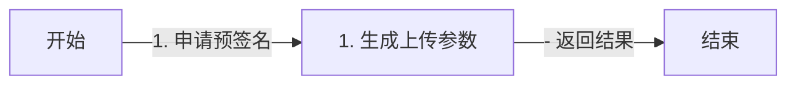

正确写法：

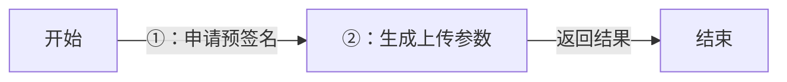

交付前检查：

- 检查节点标签：`[...]`、`{...}`、`(...)`。
- 检查连线标签：`|...|`、`-- 文字 -->`。
- `graph`/`flowchart` 的显式步骤编号优先使用 `① ② ③ … ⑳`。
- 超过 20 步时优先拆图，不继续使用字体兼容性不稳定的冷僻圈号。
- `sequenceDiagram` 默认使用 `autonumber`，不和手写圈号叠加。
- 普通 Markdown 正文中的有序列表不受影响，只限制 Mermaid 标签。

## 1. 已有 Mermaid 先判断要不要改

不要默认把旧图换成更柔和、更统一或更像当前模板的样式。修改前先按顺序检查：

```text
现有图是否需要优化
├── 已有自定义配色，并且颜色承担角色或层级含义 → 完全不改
├── 已有 subgraph、虚线框或粗描边帮助分层 → 不因审美偏好弱化
├── 只是默认黑白样式，颜色不能增加新含义 → 保持原样
└── 默认黑白样式，且颜色能区分动作、判断、边界与结果 → 可以配色
```

视觉优化和结构优化必须分开：

- **视觉优化**：只调整已有节点的颜色、描边、字体和连线样式，不改节点、文案、顺序、方向和拓扑。
- **结构优化**：拆图、合并节点、压短文案、改变方向、移动细节或改写连线。只有用户明确要求，或原图存在可指出的阅读障碍时才做。
- 现有图已经通过多类颜色区分用户、系统、产出、技术层级或分组时，即使颜色较鲜明，也不能擅自降低饱和度。颜色对复杂图的区分度通常比风格统一更重要。
- 找不到明确收益时，结论写“保持原样”，不要为了展示能力制造一张优化后版本。

### 统一的是颜色语义，不是所有图的外观

以下颜色是**新建通用图**的默认语义。已经拥有明确角色配色或领域配色的旧图、专用模板和复杂技术图，继续沿用自己的颜色系统，不重新映射。

| 语义 | 用途 | 填充色 | 描边色 | 文字色 |
|---|---|---|---|---|
| 中性 | 普通节点、背景、默认关系 | `#F8FAFC` | `#CBD5E1` | `#475569` |
| 蓝色 | 主流程、动作、进行中 | `#F2F6FF` | `#B7C9F2` | `#334155` |
| 黄色 | 判断、等待、需要确认 | `#FFF9E9` | `#E9C56A` | `#5D4A19` |
| 绿色 | 成功、完成、产出 | `#EDF8EF` | `#B8DDBF` | `#2F6B3A` |
| 红色 | 失败、风险、边界、终止 | `#FFF0F0` | `#F1C1C1` | `#7A3434` |
| 紫色 | AI、系统服务、中间层 | `#F6F0FF` | `#D3BDF0` | `#5B3A82` |
| 橙色 | 外部系统、数据库、运行环境 | `#FFF4E8` | `#F2C38B` | `#7A4A18` |

同一张图只使用其中真正有含义的颜色，通常控制在 2～4 种。不要为了凑齐色盘给每个同级节点分配不同颜色。

### 按图型决定是否加色

| 图型 | 默认策略 | 加色方式 |
|---|---|---|
| `graph LR` | 条件性加色 | 只区分根节点、主线、判断、结果或异常；普通同级分支保持同色，避免彩虹树。已有配色完全不改。 |
| `flowchart TD` | 推荐语义加色 | 无样式的新流程优先使用蓝色动作、黄色判断、绿色结果、红色异常；不要改变结构来迁就配色。 |
| `sequenceDiagram` | 默认保持原生样式 | 不给每个参与者分配一种颜色。只有跨团队或跨系统边界明显时才用 `box rgb(...)` 分组，只有异常或关键阶段需要强调时才用 `rect rgb(...)`。 |
| `stateDiagram-v2` | 推荐给关键状态加色 | 普通状态保持中性；运行中用蓝色、等待用黄色、成功用绿色、失败用红色。不要给开始/结束伪状态强加样式。 |
| `pie` | 使用分类色盘 | 饼图表达类别而不是流程，不能机械套用“红色等于失败”。同一系列保持稳定顺序，类目控制在 6 个以内；渲染环境不稳定时使用默认主题。 |
| `erDiagram` | 默认中性 | 表和关系线保持灰白；只在确有必要时给核心实体、外部实体或系统边界加色，不按表数量逐表染色。 |

执行顺序：先判断颜色能否增加信息，再选择语义色，最后检查同一张图是否出现颜色过多。不能明确说出某个颜色的含义时，就不要加。

### 只给无样式决策流程增加语义颜色

适用于原图逻辑已经正确，但仍使用 Mermaid 默认黑白样式，读者不容易快速区分“发生了什么、要做什么、在哪里判断、何时立边界、最终结果是什么”的场景。

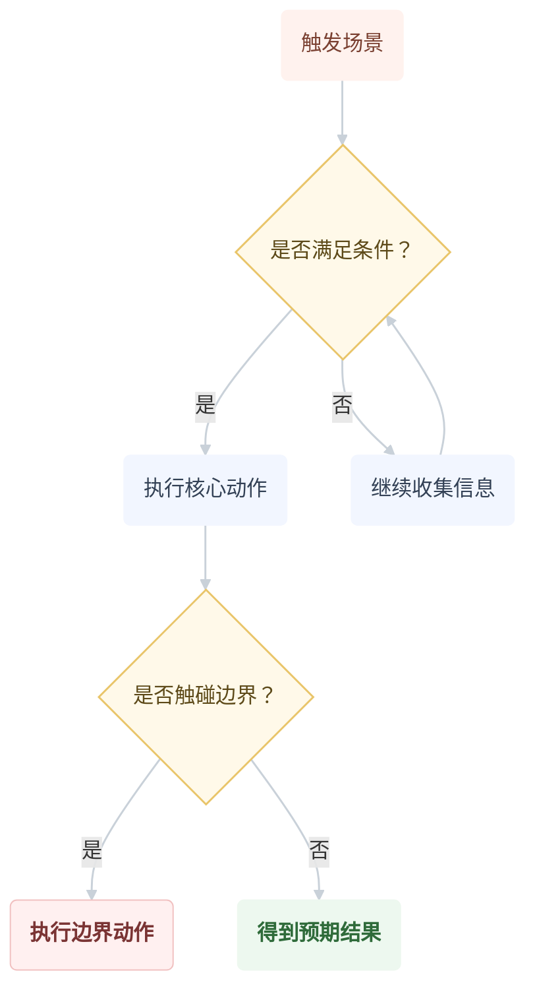

颜色语义：

- 浅橙：触发场景；
- 浅黄：判断；
- 浅蓝：可执行动作；
- 浅红：边界或停止条件；
- 浅绿：成功结果。

应用这套颜色前必须确认原图没有自己的颜色系统。如果原图已经用颜色区分人物、系统、数据层或技术组件，保留原样。

## 2. 首选：主线 + 细节展开

适合高信息密度文档：主线给所有人看，细节盒子给需要下钻的人看。

四步：

1. 用 `graph LR` 搭主线，只保留核心业务节点。
2. 用 `subgraph` 创建细节盒子。
3. 细节盒子内部用 `direction TB`，从上到下展开。
4. 用 `-.->` 从主线关键节点连到细节，表示“这里可以展开看”。

通用模板：

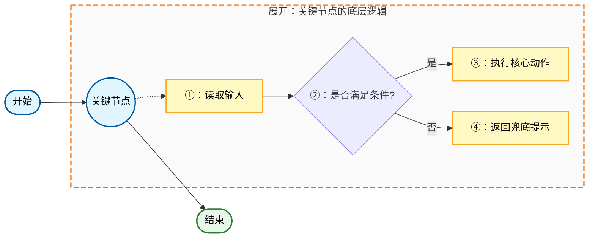

使用标准：

- 主线节点短：让读者先看懂“整体发生了什么”。
- 细节盒子只展开一个关键节点：避免一张图同时下钻太多地方。
- 颜色语义固定：蓝色主线、黄色细节、绿色结果；技术类可以把中间件、数据库单独着色。
- 连线必须有中文条件：例如 `通过`、`失败`、`库存 > 0`、`语气生硬`。

## 3. 教程/SOP 模板：用户主线 + AI 细节

适合 AI 教程、知识付费课、求职链路、简历优化、工具上手。主线用用户视角，细节盒子解释 AI/系统内部逻辑。

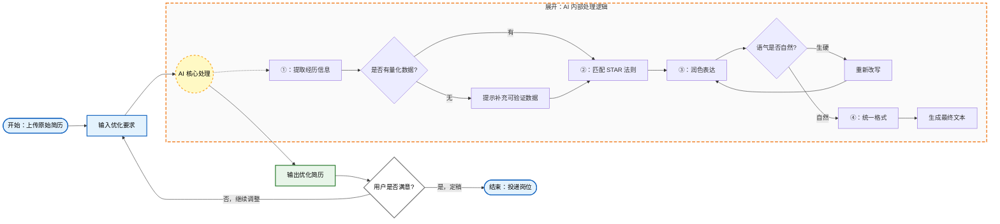

写法要点：

- 蓝色表示用户操作，黄色表示 AI/系统处理，绿色表示产出。
- 主线保留“用户要做什么”，细节盒子解释“AI 怎么处理”。
- 面向小白时，技术词后面补通俗动作，不堆术语。

## 4. 技术模板：业务主线 + 底层实现

适合技术方案、架构设计、SQL 优化、并发控制、Redis/MQ/MySQL 交互。主线给产品/测试看，细节盒子给开发看。

```mermaid
graph LR
    %% 样式区
    classDef bizNode fill:#e3f2fd,stroke:#1565c0,stroke-width:2px,color:#000;
    classDef middleware fill:#f3e5f5,stroke:#7b1fa2,stroke-width:2px,color:#000;
    classDef dbNode fill:#fff3e0,stroke:#e65100,stroke-width:2px,color:#000;
    classDef noteNode fill:#fce4ec,stroke:#880e4f,stroke-width:2px,stroke-dasharray: 8 4,color:#000;
    classDef decision fill:#fff,stroke:#757575,stroke-width:2px,color:#000;

    %% 主业务流程
    Start([用户点击秒杀]):::bizNode --> Check{资格校验}:::decision
    Check -- 通过 --> Deduct((扣减库存)):::bizNode
    Check -- 不通过 --> Fail([返回：不符合条件]):::bizNode
    Deduct --> CreateOrder[创建订单]:::bizNode
    CreateOrder --> End([返回：抢购成功]):::bizNode

    %% 技术细节展开
    subgraph Tech_Impl [展开：底层并发与缓存实现]
        direction TB
        Deduct -.-> Redis[①：访问 Redis 缓存]:::middleware
        Redis --> Lua{执行 Lua 脚本}:::middleware
        Lua -- 库存 > 0 --> Decr[原子扣减库存]:::middleware
        Lua -- 库存 <= 0 --> ReturnFail[直接返回失败，防止 DB 穿透]:::middleware
        Decr --> MQ[②：发送消息到 MQ]:::middleware
        MQ --> TTL[消息 TTL：60 秒，削峰填谷]:::noteNode
        TTL --> DB[③：异步写入 MySQL]:::dbNode
        DB --> Lock[加行锁：SELECT FOR UPDATE]:::dbNode
        Lock --> Commit[事务提交并释放锁]:::dbNode
        Commit --> Note[注意：锁粒度按商品或课程 ID 控制]:::noteNode
    end

    style Tech_Impl fill:#fff8fb,stroke:#880e4f,stroke-width:2px,stroke-dasharray: 8 4
```

写法要点：

- 蓝色表示业务节点，紫色表示中间件，橙色表示数据库，粉色表示风险/参数/注意事项。
- TTL、锁粒度、SQL 关键字、队列策略放在备注节点里，不塞进主线。
- 异常路径要显式画出来，例如库存不足、快速失败、防穿透。

## 5. 树状分支：graph LR

适合复杂分支、运行规则、错误兜底。用户最偏好的主力模板。

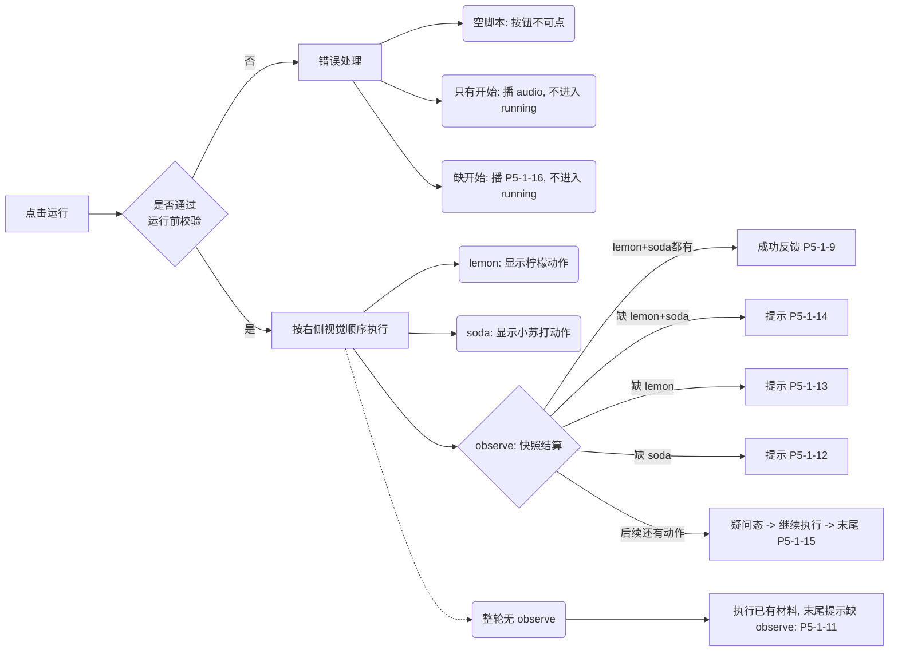

写法习惯：

- `graph LR` 适合像树一样左右展开。
- 用 `%%` 给大分支加注释，方便后续维护。
- 分支很多时，优先保留业务语义，不要为了图形规整删条件。

## 6. 标准流程：flowchart TD

适合更正式的流程图，从上到下读。

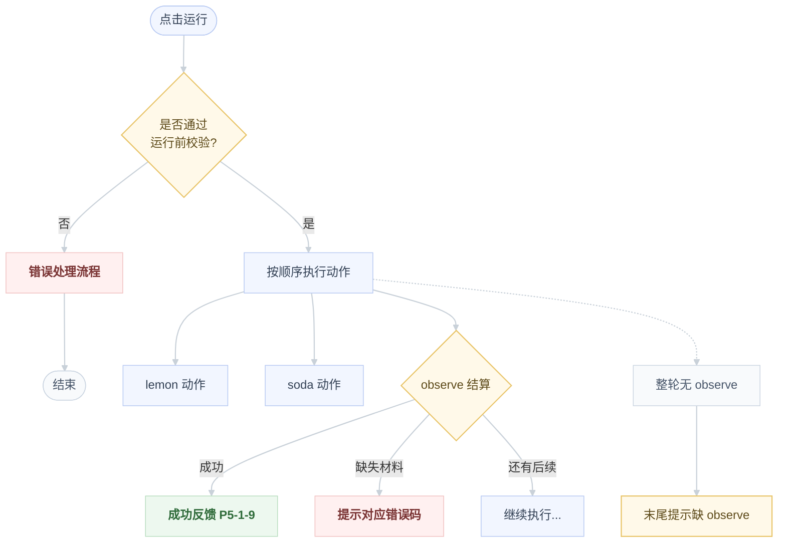

这是新建标准流程的默认示例；如果材料只包含单一路径、没有判断和异常，保持原生样式即可。

## 7. 多角色交互：sequenceDiagram

适合用户、界面层、逻辑层、音频模块、后端之间的调用顺序。

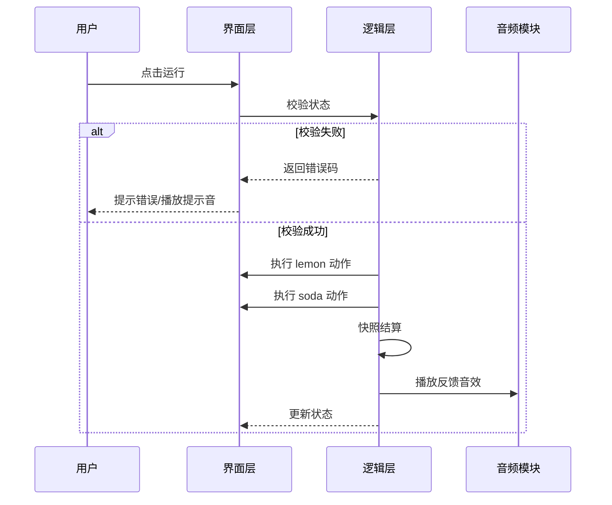

## 8. 状态流转：stateDiagram-v2

适合描述一个对象从初始态到运行、成功、失败、警告的变化。

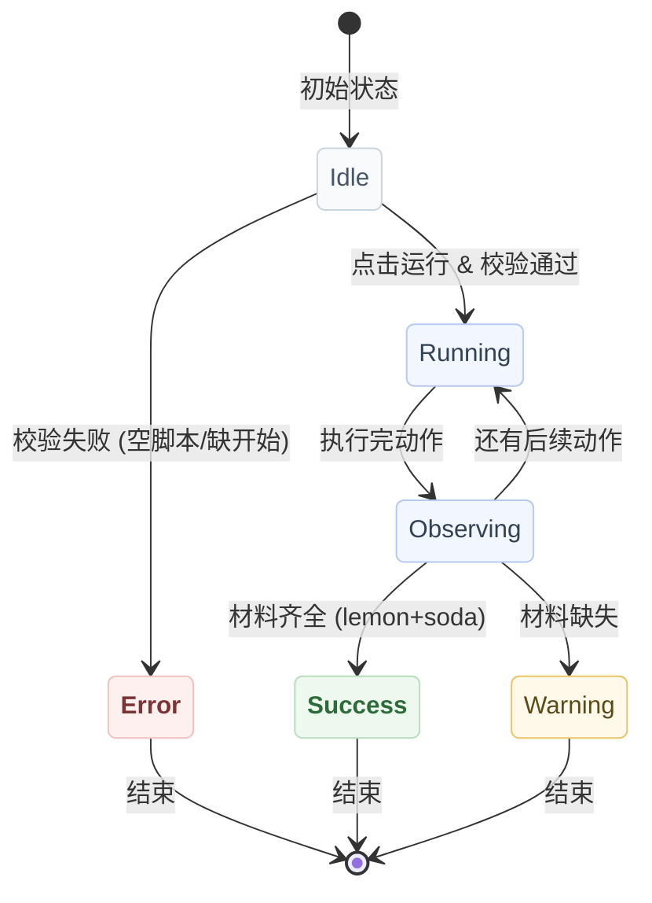

只给承载业务含义的状态加色；开始与结束伪状态保持 Mermaid 默认样式。

## 9. 数据库关系：erDiagram

只有在材料明确涉及表、实体、字段关系时使用。

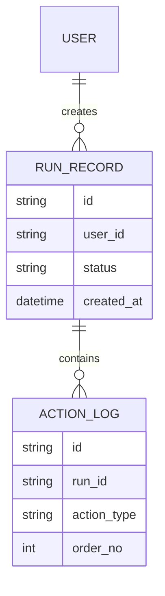

默认不加色。只有读者需要快速区分核心域与外部域时，才给少数实体增加 `classDef`；不能用颜色代替实体命名和关系基数。

## 10. 占比：pie

只有在材料明确有占比、类目较少时使用。

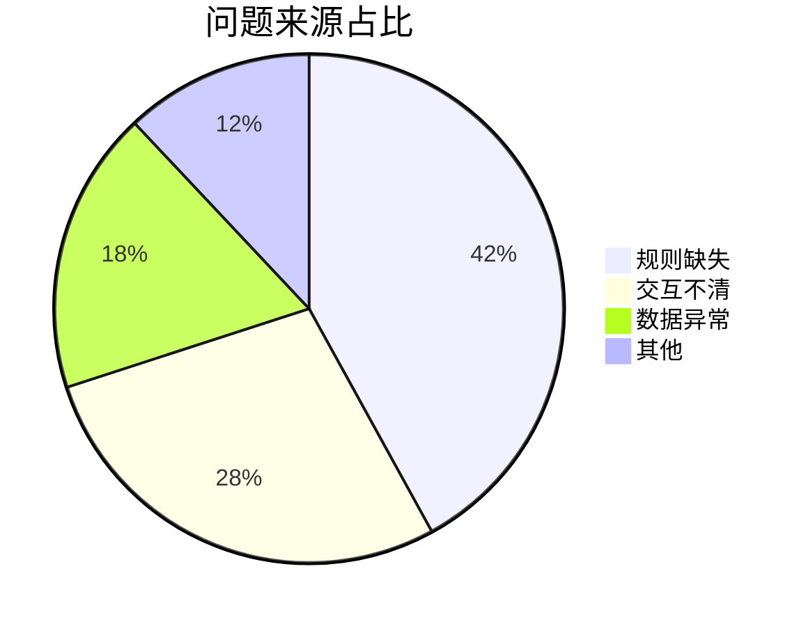

饼图颜色用于区分类别，不复用流程图的成功、判断、失败语义。跨文档比较同一组类别时保持系列顺序一致；否则优先使用渲染器默认色盘。

## 不主动使用

- 不主动用 `mindmap`。
- 不主动用 `classDiagram`。
- 不主动用复杂高级图种。
- 如果只是层级结构，用 ASCII 树或普通无序列表。
